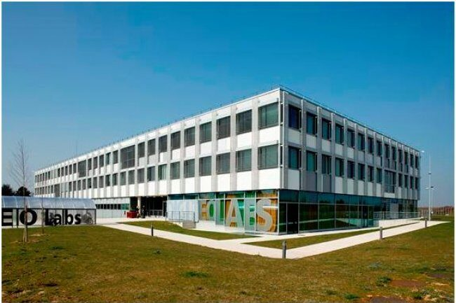

---
hide:
  - navigation
  - toc
---

# Calcul Haute Performance

Master 2 Dynamique des Fluides et Énergétique — Université Paris-Saclay

Les bases du calcul haute performance et de la programmation parallèle
par échange de messages avec MPI.

[Commencer le cours](introduction/index.md){ .md-button .md-button--primary }
[Voir le dépôt GitHub](https://github.com/Maison-de-la-Simulation/HPC-DFE-Paris-Saclay){ .md-button }

## Contenu du cours

-   :material-laptop:{ .lg .middle } __Installer le cours__

    ---

    Installer Python, MPI et le dépôt du cours sur votre ordinateur :
    Linux, macOS et Windows.

    [:octicons-arrow-right-24: Suivre le guide](installation.md)

-   :material-rocket-launch:{ .lg .middle } __I. Introduction au calcul parallèle__

    ---

    Qu'est-ce que le HPC, un peu d'histoire et le fonctionnement d'un
    super-calculateur.

    [:octicons-arrow-right-24: Lire le chapitre](introduction/index.md)

-   :material-server:{ .lg .middle } __II. Prise en main d'un super-calculateur__

    ---

    Architecture, connexion, environnement et soumission de jobs avec
    SLURM sur le super-calculateur Ruche.

    [:octicons-arrow-right-24: Lire le chapitre](super-calculateur/index.md)

-   :material-transit-connection-variant:{ .lg .middle } __III. Parallélisme par échange de messages (MPI)__

    ---

    Communications point à point, collectives, topologies, avec Python
    et mpi4py.

    [:octicons-arrow-right-24: Lire le chapitre](mpi/index.md)

-   :material-database:{ .lg .middle } __IV. Écriture parallèle avec HDF5__

    ---

    Stratégies d'écriture, format HDF5, écriture d'un fichier unique en
    parallèle avec h5py.

    [:octicons-arrow-right-24: Lire le chapitre](hdf5/index.md)

-   :material-sine-wave:{ .lg .middle } __V. FFT distribuée__

    ---

    Principe d'une FFT distribuée, bibliothèque mpi4py-fft et résolution
    de l'équation de Poisson du TP Kelvin-Helmholtz.

    [:octicons-arrow-right-24: Lire le chapitre](fft/index.md)

-   :material-speedometer:{ .lg .middle } __VI. Mesure de la performance__

    ---

    Déséquilibre de charge, scalabilité forte et faible, efficacité et
    loi d'Amdahl.

    [:octicons-arrow-right-24: Lire le chapitre](performance/index.md)

-   :material-cube-scan:{ .lg .middle } __VII. Visualisation avec ParaView__

    ---

    Interface, pipeline de filtres, particules, coupes et isosurfaces,
    scripts `pvpython`, appliqués aux TPs Marble et Kelvin-Helmholtz.

    [:octicons-arrow-right-24: Lire le chapitre](paraview/index.md)

-   :material-flask:{ .lg .middle } __VIII. Travaux pratiques__

    ---

    Exercices et TPs dans le dépôt GitHub du cours.

    [:octicons-arrow-right-24: Exercices](https://github.com/Maison-de-la-Simulation/HPC-DFE-Paris-Saclay/tree/master/exercices) ·
    [:octicons-arrow-right-24: TPs](https://github.com/Maison-de-la-Simulation/HPC-DFE-Paris-Saclay/tree/master/tp)

## Qui suis-je ?

**Mathieu Lobet** — ingénieur-chercheur à la
[Maison de la Simulation](https://www.maisondelasimulation.fr/), CEA Saclay.

- Thèse en physique des plasmas
- Optimisation CPU et programmation GPU
- Développement de codes de physique (par exemple [Smilei](https://smileipic.github.io/Smilei/))
- Traitement automatisé par l'IA

La Maison de la Simulation est un laboratoire multi-tutelle CEA, CNRS et
Université Paris-Saclay, situé près du campus, au CEA Saclay. Elle est
spécialisée dans le calcul scientifique : mathématiques appliquées,
développement de codes et de bibliothèques, calcul parallèle, analyse des
données et IA pour le calcul scientifique.

!!! tip "Un cours en accès libre"

    Tout le cours (supports, exercices, TPs) est disponible sur GitHub :
    [Maison-de-la-Simulation/HPC-DFE-Paris-Saclay](https://github.com/Maison-de-la-Simulation/HPC-DFE-Paris-Saclay).
    N'hésitez pas à ouvrir une *issue* si vous repérez une erreur.
