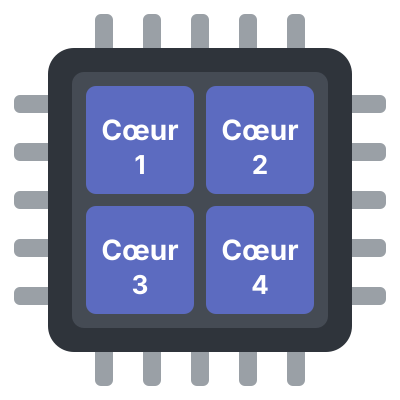
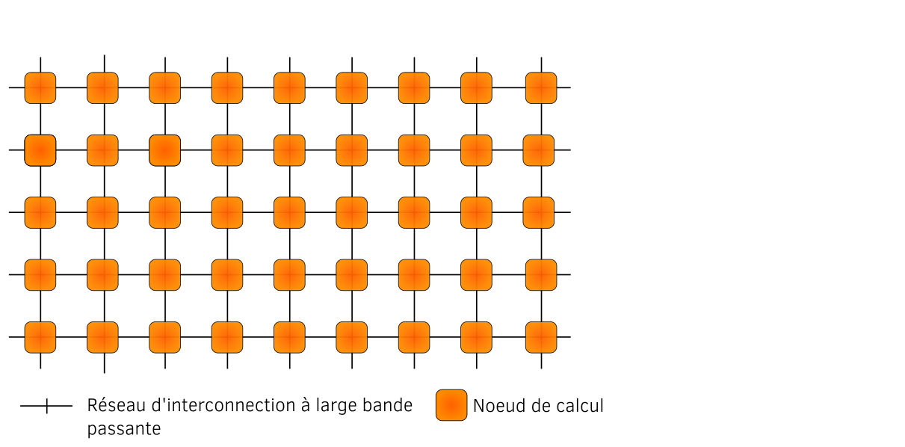
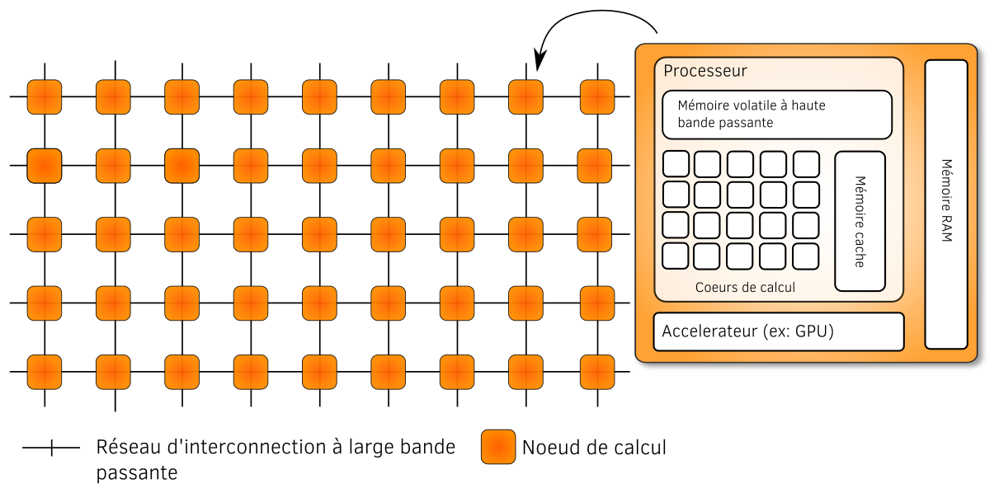
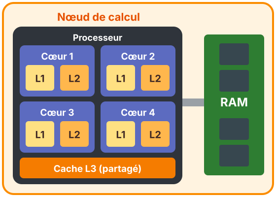

# 4. Fonctionnement d'un super-calculateur

## Une machine parallèle avant tout

Un super-calculateur est une machine composée d'un grand nombre d'unités de calcul connectées entre elle. On parle aussi de machine parallèle.

Les processeurs de nos ordinateurs, de nos téléphones portables, ou nos
cartes graphiques, sont tous aujourd'hui des machines parallèles : ils sont
composés de plusieurs **cœurs de calcul**.

<div class="grid cards" markdown>

-   { .on-white }

    **Ordinateur** — contient un ou plusieurs processeurs, de la mémoire
    vive et éventuellement un GPU.

-   { .on-white }

    **Processeur (CPU)** — composé de plusieurs **cœurs** (unités de calcul),
    ici 4.

-   { .on-white }

    **GPU (carte graphique)** — des milliers d'unités de calcul plus simples.

-   { .on-white }

    **Mémoire vive (RAM)** — stocke les données pendant le calcul.

</div>

## Principe d'un super-calculateur

Un super-calculateur est un ensemble de **nœuds de calcul** reliés par un
**réseau d'interconnexion** à large bande passante. Chaque nœud ressemble
à un ordinateur : il contient des processeurs, de la mémoire et parfois
des accélérateurs (GPU).

=== "Vue d'ensemble"

    { .on-white }

=== "Zoom sur un nœud"

    { .on-white }

### De la puce à la machine

Physiquement, un super-calculateur est un **emboîtement de briques**, de
la plus petite à la plus grande :

--8<-- "introduction/briques-supercalculateur.svg"

Cœur
:   L'unité de calcul élémentaire, qui exécute les instructions.

Processeur et socket
:   Le processeur est une puce qui regroupe aujourd'hui des dizaines de
    cœurs. Le *socket* est, à l'origine, le support de la carte mère dans
    lequel on l'installe ; par extension, on parle d'un nœud « à 2
    sockets » pour un nœud à 2 processeurs.

Nœud, ou lame (*blade*)
:   L'équivalent d'un ordinateur : une carte avec 1 ou 2 processeurs, de
    la mémoire vive et parfois des GPU. Les nœuds sont souvent montés sur
    des cartes fines, les **lames**, qui peuvent porter un ou plusieurs
    nœuds.

Châssis
:   Un boîtier qui accueille plusieurs lames et leur fournit
    l'alimentation électrique et le refroidissement.

Armoire, baie ou rack (*cabinet*)
:   Plusieurs châssis empilés, avec les **switchs** du réseau
    d'interconnexion qui relient les nœuds entre eux.

Super-calculateur
:   Des dizaines à des centaines d'armoires, alignées dans une salle
    machine et reliées par le réseau.

!!! example "Un exemple : Frontier"

    Frontier, le premier super-calculateur exaflopique (2022), compte
    **74 armoires** et **9 408 nœuds**. Chaque nœud contient un
    processeur AMD EPYC de 64 cœurs et 4 GPU AMD MI250X.

!!! note "Un vocabulaire qui varie"

    Les constructeurs (HPE Cray, Eviden, Lenovo…) ne découpent pas tous
    leurs machines de la même façon : nombre de nœuds par lame, de lames
    par châssis, de châssis par armoire. Les ordres de grandeur du schéma
    sont indicatifs.

## Architectures mémoire

### Système à mémoire distribuée

Système composé d'un ensemble d'unités de calcul (ou d'ordinateurs)
connectées entre elles par un **réseau de communication rapide**, chacune
possédant une **mémoire vive strictement privée**.

--8<-- "introduction/memoire-distribuee.svg"

### Système à mémoire partagée

Système composé d'un ensemble d'unités de calcul **partageant la même
mémoire vive**.

--8<-- "introduction/memoire-partagee.svg"

### Les différents niveaux de parallélisme d'un super-calculateur

Un super-calculateur combine les deux architectures :

<div class="grid cards" markdown>

-   { .on-white }

    **Parallélisme inter-nœuds** (*internode parallelism*) : entre les
    nœuds, chacun ayant sa propre mémoire. C'est un modèle à **mémoire
    distribuée**.

-   { .on-white }

    **Parallélisme intra-nœud** (*intranode parallelism*) : entre les
    cœurs d'un même nœud, qui partagent sa mémoire vive (RAM). C'est un
    modèle à **mémoire partagée**.

    Entre les cœurs et la RAM, le processeur dispose de **caches** :
    de petites mémoires très rapides. En général, chaque cœur a ses
    propres caches L1 et L2, et le cache L3 est partagé par tous les
    cœurs.

</div>

## Exploiter la puissance de calcul

Être capable d'exploiter **toute** la puissance de calcul d'une machine
dépend de nombreux paramètres :

- les caractéristiques du **réseau** reliant les nœuds (architecture,
  bande passante, latence) ;
- les **couches logicielles** utilisées ;
- le type d'**algorithme** à paralléliser ;
- le niveau d'**optimisation** des programmes.

C'est toute l'expertise du Calcul Haute Performance.

## Les langages de programmation en HPC

| Langage | Usage |
|---|---|
| **Fortran** | Historiquement *le* langage du calcul scientifique, en perte de vitesse aujourd'hui. |
| **C / C++** | Le C++ en particulier est de plus en plus utilisé et recommandé : il intègre de nombreuses fonctionnalités et bibliothèques. |
| **Python** | Principalement utilisé pour le squelette des codes, le post-traitement et l'analyse des données. |
| **Julia** | Loin d'être le plus courant, mais facile à utiliser tout en étant performant. |

D'autres langages existent mais sont moins couramment utilisés en
production.

## Les modèles de programmation parallèle

### Sur CPU

Un processeur offre du parallélisme à **trois niveaux**, et chacun a ses
propres modèles de programmation :

| Niveau | Mémoire | Ce qui travaille en parallèle | Modèles principaux |
|---|---|---|---|
| Entre les nœuds | Distribuée | des **processus** | MPI |
| Entre les cœurs d'un nœud | Partagée | des **processus** ou des **threads** | OpenMP, threads, MPI |
| Dans un cœur | Registres | les éléments d'un **vecteur** (SIMD) | Vectorisation par le compilateur |

Processus
:   Un programme en cours d'exécution, avec **sa propre mémoire**. Deux
    processus ne voient pas la mémoire l'un de l'autre : pour partager des
    données, ils doivent s'envoyer des messages.

Thread (fil d'exécution)
:   Un flot d'instructions **à l'intérieur d'un processus**. Les threads
    d'un même processus **partagent sa mémoire** : ils peuvent lire et
    écrire les mêmes variables, ce qui impose de bien coordonner leurs
    accès.

=== "Mémoire distribuée"

    **MPI** (*Message Passing Interface*)
    :   Le standard du calcul parallèle sur super-calculateur depuis les
        années 1990. Chaque processus a sa propre mémoire et échange des
        données par **messages**. MPI est une norme, pas un logiciel : il
        en existe plusieurs implémentations (Open MPI, MPICH, Intel MPI…).
        Il s'utilise en C, C++ et Fortran, et en Python avec **mpi4py**.
        Il fonctionne entre les nœuds comme entre les cœurs d'un même
        nœud. **C'est celui que nous allons apprendre.**

    **PGAS** (*Partitioned Global Address Space*)
    :   Des modèles où chaque processus peut lire directement la mémoire
        des autres, comme si elle était partagée : *coarrays* de Fortran
        (intégrés à la norme Fortran 2008), UPC++, OpenSHMEM, Chapel.
        Ils restent bien moins répandus que MPI.

=== "Mémoire partagée"

    **OpenMP**
    :   Le modèle de référence en mémoire partagée. On ajoute au code des
        **directives** qui indiquent au compilateur quelles boucles
        répartir entre les threads. On peut ainsi paralléliser un code
        existant petit à petit. Disponible en C, C++ et Fortran.

        ```c
        // La somme d'un tableau, répartie entre les threads
        #pragma omp parallel for reduction(+:sum)
        for (int i = 0; i < n; i++)
            sum += a[i];
        ```

    **Threads explicites**
    :   Le programmeur crée et synchronise lui-même les threads : POSIX
        threads (`pthreads`) en C, `std::thread` en C++. C'est plus
        souple, mais plus bas niveau et plus propice aux erreurs.

    **Bibliothèques C++**
    :   Les algorithmes parallèles de la bibliothèque standard depuis
        C++17 (`std::execution::par`), oneTBB (Intel), ou Kokkos, qui
        utilise OpenMP sur CPU et sait aussi cibler les GPU.

=== "Vectorisation (SIMD)"

    À l'intérieur d'un cœur, une **instruction vectorielle** applique la
    même opération à plusieurs données à la fois (*Single Instruction,
    Multiple Data*). Par exemple, avec les instructions AVX-512, un cœur
    additionne 8 nombres en double précision en une seule instruction.

    - Le plus souvent, c'est le **compilateur** qui vectorise
      automatiquement les boucles simples.
    - On peut l'y aider avec des directives (`#pragma omp simd`), ou
      écrire directement les instructions vectorielles (*intrinsics*).
    - En Python, les opérations NumPy sur des tableaux entiers
      (`a + b`) s'exécutent dans des boucles compilées et vectorisées,
      d'où leur rapidité par rapport à une boucle Python.

    Ce parallélisme est invisible pour le programmeur, mais il compte
    beaucoup dans la puissance théorique d'un processeur.

=== "En Python"

    Python a une particularité : le **GIL** (*Global Interpreter Lock*)
    empêche plusieurs threads d'exécuter du code Python en même temps.
    Pour du calcul en Python pur, on utilise donc plutôt des
    **processus** :

    | Outil | Principe |
    |---|---|
    | **mpi4py** | MPI en Python, sur un ou plusieurs nœuds. C'est ce que nous utiliserons. |
    | **multiprocessing**, **concurrent.futures** | Bibliothèque standard : répartir des tâches entre plusieurs processus d'un même nœud. |
    | **Numba** | Compilation à la volée de fonctions Python, avec des boucles parallèles en threads (`prange`). |
    | **Dask**, **joblib** | Répartir des tâches ou de gros tableaux sur les cœurs d'un nœud, voire sur plusieurs nœuds (Dask). |

    Par ailleurs, NumPy et SciPy appellent des bibliothèques compilées
    (OpenBLAS, MKL) qui sont elles-mêmes parallélisées : un produit de
    matrices utilise déjà plusieurs cœurs sans que vous ayez rien à
    faire.

    !!! note "Un Python sans GIL"

        Depuis Python 3.13, il existe une version expérimentale de
        l'interpréteur sans GIL, dans laquelle les threads peuvent
        réellement calculer en parallèle.

=== "Hybride"

    Sur un super-calculateur, on combine souvent les modèles : **MPI
    entre les nœuds** et **OpenMP entre les cœurs** de chaque nœud
    (approche dite *MPI + OpenMP*). Cela correspond aux deux niveaux de
    parallélisme de la machine, et cela réduit le nombre de processus MPI
    et la mémoire qu'ils consomment.

    On peut aussi n'utiliser que MPI, avec un processus par cœur : c'est
    plus simple à programmer, et c'est l'approche de ce cours.

### Sur GPU

Sur GPU, il existe des modèles de programmation spécifiques :

| Modèle | Description |
|---|---|
| **CUDA** | Le modèle de référence, le plus technique, pour les GPU NVIDIA (HIP en est l'équivalent chez AMD). |
| **OpenCL** | Concurrent de CUDA plus généraliste, mais un peu moins performant. |
| **OpenACC** | Approche par directives permettant un portage plus rapide et avec moins d'expertise que CUDA, surtout supportée sur cartes NVIDIA. |
| **OpenMP target** | Extension d'OpenMP pour les GPU, très proche d'OpenACC, plus généraliste mais moins performante. |
| **Kokkos / RAJA** | Méta-programmation en C++ offrant un haut niveau de performance et la portabilité de la performance. |
| **SYCL** | Modèle proche de Kokkos, soutenu notamment par Intel pour ses propres GPU. |
| **JAX, Numba, CuPy** | Modèles Python « à la NumPy » pour la programmation multi-architecture, avec compilation à la volée (JIT). |

!!! success "Pour ce cours"

    - **Python** comme langage, car c'est celui que vous avez le plus
      l'habitude d'utiliser ;
    - **MPI** comme modèle de programmation parallèle, car c'est le plus
      courant aujourd'hui sur CPU.
