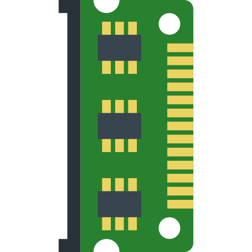
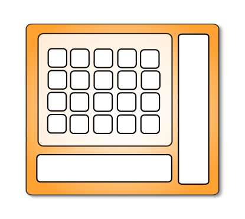

# 3. Fonctionnement d'un super-calculateur

## Une machine parallèle avant tout

Un super-calculateur est avant tout une **machine parallèle**, c'est-à-dire
une machine composée de plusieurs unités de calcul connectées.

Les processeurs de nos ordinateurs, de nos téléphones portables, ou nos
cartes graphiques, sont tous aujourd'hui des machines parallèles : ils sont
composés de plusieurs **cœurs de calcul**.

-   { .on-white }

    **Ordinateur** — contient un ou plusieurs processeurs, de la mémoire
    vive et éventuellement un GPU.

-   { .on-white }

    **Processeur (CPU)** — composé de plusieurs **cœurs** (unités de calcul).

-   { .on-white }

    **GPU (carte graphique)** — des milliers d'unités de calcul plus simples.

-   { .on-white }

    **Mémoire vive (RAM)** — stocke les données pendant le calcul.

## Principe d'un super-calculateur

Un super-calculateur est un ensemble de **nœuds de calcul** reliés par un
**réseau d'interconnexion** à large bande passante. Chaque nœud ressemble
à un ordinateur : il contient des processeurs, de la mémoire et parfois
des accélérateurs (GPU).

=== "Vue d'ensemble"

    { .on-white }

=== "Zoom sur un nœud"

    { .on-white }

## Architectures mémoire

### Système à mémoire distribuée

Système composé d'un ensemble d'unités de calcul (ou d'ordinateurs)
connectées entre elles par un **réseau de communication rapide**, chacune
possédant une **mémoire vive strictement privée**.

<svg class="diagram" viewBox="0 0 560 250" role="img" aria-label="Quatre unités de calcul, chacune avec sa propre mémoire vive, reliées par un réseau">
<rect class="bus" x="40" y="203" width="480" height="24" rx="12"/>
<text x="280" y="215">réseau</text>
<g><rect class="mem" x="30" y="20" width="110" height="50" rx="6"/><text x="85" y="45">Mémoire vive</text><line class="link" x1="85" y1="70" x2="85" y2="100"/><rect class="cpu" x="30" y="100" width="110" height="60" rx="6"/><text x="85" y="130">Unité de calcul</text><line class="link" x1="85" y1="160" x2="85" y2="203"/></g>
<g><rect class="mem" x="160" y="20" width="110" height="50" rx="6"/><text x="215" y="45">Mémoire vive</text><line class="link" x1="215" y1="70" x2="215" y2="100"/><rect class="cpu" x="160" y="100" width="110" height="60" rx="6"/><text x="215" y="130">Unité de calcul</text><line class="link" x1="215" y1="160" x2="215" y2="203"/></g>
<g><rect class="mem" x="290" y="20" width="110" height="50" rx="6"/><text x="345" y="45">Mémoire vive</text><line class="link" x1="345" y1="70" x2="345" y2="100"/><rect class="cpu" x="290" y="100" width="110" height="60" rx="6"/><text x="345" y="130">Unité de calcul</text><line class="link" x1="345" y1="160" x2="345" y2="203"/></g>
<g><rect class="mem" x="420" y="20" width="110" height="50" rx="6"/><text x="475" y="45">Mémoire vive</text><line class="link" x1="475" y1="70" x2="475" y2="100"/><rect class="cpu" x="420" y="100" width="110" height="60" rx="6"/><text x="475" y="130">Unité de calcul</text><line class="link" x1="475" y1="160" x2="475" y2="203"/></g>
</svg>

### Système à mémoire partagée

Système composé d'un ensemble d'unités de calcul **partageant la même
mémoire vive**.

<svg class="diagram" viewBox="0 0 560 250" role="img" aria-label="Quatre unités de calcul reliées à une mémoire vive commune">
<rect class="mem" x="30" y="20" width="500" height="55" rx="6"/>
<text x="280" y="47">Mémoire vive</text>
<rect class="bus" x="30" y="100" width="500" height="24" rx="12"/>
<text x="280" y="112">connexion</text>
<line class="link" x1="280" y1="75" x2="280" y2="100"/>
<g><line class="link" x1="85" y1="124" x2="85" y2="160"/><rect class="cpu" x="30" y="160" width="110" height="60" rx="6"/><text x="85" y="190">Unité de calcul</text></g>
<g><line class="link" x1="215" y1="124" x2="215" y2="160"/><rect class="cpu" x="160" y="160" width="110" height="60" rx="6"/><text x="215" y="190">Unité de calcul</text></g>
<g><line class="link" x1="345" y1="124" x2="345" y2="160"/><rect class="cpu" x="290" y="160" width="110" height="60" rx="6"/><text x="345" y="190">Unité de calcul</text></g>
<g><line class="link" x1="475" y1="124" x2="475" y2="160"/><rect class="cpu" x="420" y="160" width="110" height="60" rx="6"/><text x="475" y="190">Unité de calcul</text></g>
</svg>

### Les différents niveaux de parallélisme d'un super-calculateur

Un super-calculateur combine les deux architectures :

-   { .on-white }

    **Parallélisme inter-nœuds** (*internode parallelism*) : entre les
    nœuds, chacun ayant sa propre mémoire. C'est un modèle à **mémoire
    distribuée**.

-   { .on-white }

    **Parallélisme intra-nœud** (*intranode parallelism*) : entre les
    cœurs d'un même nœud, qui partagent sa mémoire. C'est un modèle à
    **mémoire partagée**.

## Exploiter la puissance de calcul

Être capable d'exploiter **toute** la puissance de calcul d'une machine
dépend de nombreux paramètres :

- les caractéristiques du **réseau** reliant les nœuds (architecture,
  bande passante, latence) ;
- les **couches logicielles** utilisées ;
- le type d'**algorithme** à paralléliser ;
- le niveau d'**optimisation** des programmes.

C'est toute l'expertise du Calcul Haute Performance.

## Les langages de programmation en HPC

| Langage | Usage |
|---|---|
| **Fortran** | Historiquement *le* langage du calcul scientifique, en perte de vitesse aujourd'hui. |
| **C / C++** | Le C++ en particulier est de plus en plus utilisé et recommandé : il intègre de nombreuses fonctionnalités et bibliothèques. |
| **Python** | Principalement utilisé pour le squelette des codes, le post-traitement et l'analyse des données. |
| **Julia** | Loin d'être le plus courant, mais facile à utiliser tout en étant performant. |

D'autres langages existent mais sont moins couramment utilisés en
production.

## Les modèles de programmation parallèle

=== "CPU"

    Il existe de nombreux modèles, souvent liés à des bibliothèques ou
    fournis par le standard du langage. Les deux plus connus sont :

    MPI (*Message Passing Interface*)
    :   L'un des plus utilisés, car il fonctionne à la fois en mémoire
        partagée et en mémoire distribuée. **C'est celui que nous allons
        apprendre.**

    OpenMP
    :   Très utilisé en mémoire partagée.

=== "GPU"

    Sur GPU, il existe des modèles de programmation spécifiques :

    | Modèle | Description |
    |---|---|
    | **CUDA** | Le modèle de référence, le plus technique, pour les GPU NVIDIA (HIP en est l'équivalent chez AMD). |
    | **OpenCL** | Concurrent de CUDA plus généraliste, mais un peu moins performant. |
    | **OpenACC** | Approche par directives permettant un portage plus rapide et avec moins d'expertise que CUDA, surtout supportée sur cartes NVIDIA. |
    | **OpenMP target** | Extension d'OpenMP pour les GPU, très proche d'OpenACC, plus généraliste mais moins performante. |
    | **Kokkos / RAJA** | Méta-programmation en C++ offrant un haut niveau de performance et la portabilité de la performance. |
    | **SYCL** | Modèle proche de Kokkos, soutenu notamment par Intel pour ses propres GPU. |
    | **JAX, Numba, CuPy** | Modèles Python « à la NumPy » pour la programmation multi-architecture, avec compilation à la volée (JIT). |

!!! success "Pour ce cours"

    - **Python** comme langage, car c'est celui que vous avez le plus
      l'habitude d'utiliser ;
    - **MPI** comme modèle de programmation parallèle, car c'est le plus
      courant aujourd'hui sur CPU.

## Testez-vous

??? question "Un programme MPI lancé sur 4 nœuds : quel(s) niveau(x) de parallélisme exploite-t-il ?"

    Le parallélisme **inter-nœuds** (mémoire distribuée), et aussi le
    parallélisme **intra-nœud** si l'on lance plusieurs processus MPI par
    nœud : MPI fonctionne dans les deux cas.

??? question "Dans un système à mémoire distribuée, comment une unité de calcul accède-t-elle aux données d'une autre ?"

    Elle ne peut pas y accéder directement : les données doivent être
    **envoyées à travers le réseau** sous forme de messages. C'est
    précisément le rôle de MPI.
