# 2. Un peu d'histoire

Pour mesurer le chemin parcouru, certaines machines sont comparées à un appareil
que vous connaissez bien : votre smartphone.

## 1940 – 1960 : les prémices

L'histoire des ordinateurs démarre doucement un peu avant la Seconde Guerre
mondiale, et voit ses premiers systèmes appliqués (électromécaniques ou
électroniques) pendant la guerre.

**ENIAC** (1945), l'un des premiers ordinateurs électroniques.

🇺🇸 USA50 kflop/s150 kW

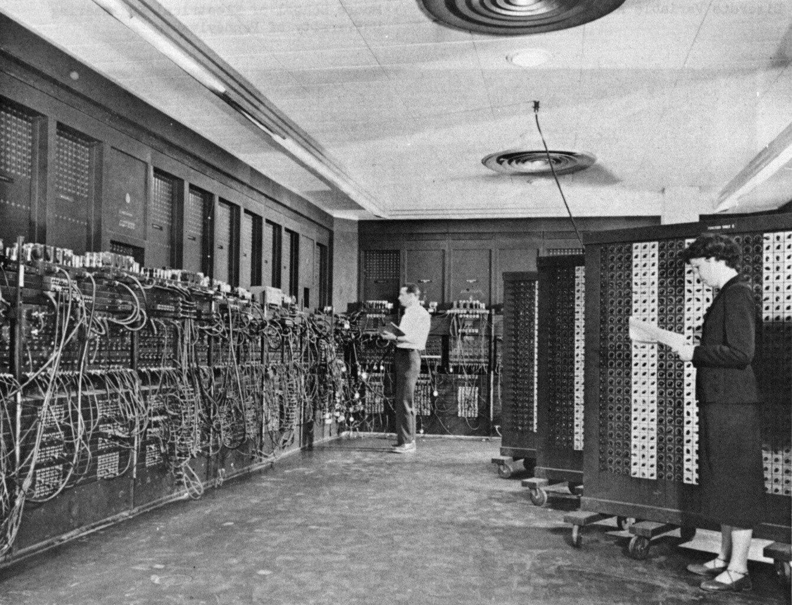

## 1960 – 1970 : la naissance d'une industrie

Les super-ordinateurs destinés au calcul scientifique au sens propre
émergent au début des années 60. C'est aussi la naissance du **Fortran**.

**CDC 6600** (1964), l'un des premiers vrais succès du HPC.

🇺🇸 USA0,5 Mflop/s30 kW

## 1970 – 1990 : l'ère des machines vectorielles et de Cray

Seymour Cray, l'un des concepteurs du CDC 6600, fonde sa propre société,
qui devient l'un des leaders du marché pendant 15 ans.

Les Cray utilisent un **processeur vectoriel** : le même calcul est
effectué en même temps sur tous les éléments d'un vecteur de données.

Prenons le calcul \(c = a + b\) sur des tableaux. Un processeur
**scalaire** traite les nombres un par un : une instruction par addition.
Un processeur **vectoriel** charge plusieurs nombres dans un **registre
vectoriel** et les additionne tous avec une seule instruction :

--8<-- "introduction/vectorisation.svg"

Le Cray-1 possède 8 registres vectoriels de **64 nombres** de 64 bits
chacun : une seule instruction lance 64 calculs. Les nombres passent ensuite
à la chaîne (*pipeline*) dans l'unité de calcul, qui produit un résultat à
chaque cycle. En enchaînant une multiplication et une addition, le Cray-1
effectue 2 opérations par cycle : à 80 MHz, il atteint 160 Mflop/s.

-   

    **Cray-1** (1975) — vectorisation très efficace, à la fois esthétique
    et performant.

    🇺🇸 USA160 Mflop/s115 kW📱 ≈ iPhone 1

-   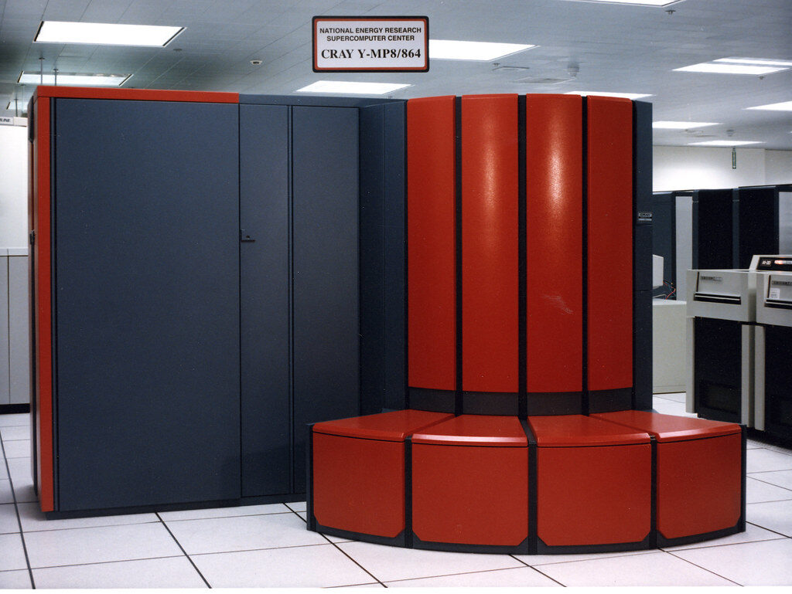

    **Cray Y-MP** (1988) — 2 à 8 processeurs vectoriels à mémoire
    partagée, 333 Mflop/s par processeur.

    🇺🇸 USA2,6 Gflop/s📱 ≈ iPhone 5

## 1990 – aujourd'hui : le parallélisme massif distribué

D'un point de vue économique et technique, il devient de plus en plus
intéressant de **mettre en réseau des processeurs issus du grand public**.
On utilise des processeurs de la micro-informatique légèrement adaptés au
monde du HPC, ce qui permet :

- l'homogénéisation des outils de développement ;
- l'abaissement des coûts de R&D et de production ;
- le retour au processeur **scalaire** (une opération sur une donnée).

-   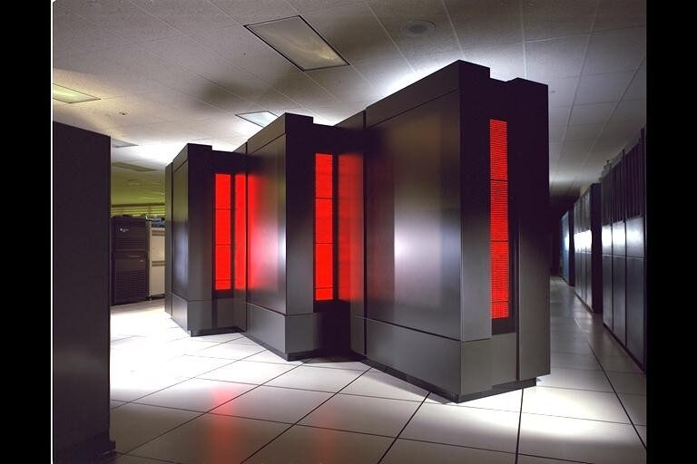

    **CM-5** (1993) — 1024 processeurs, premier du TOP500 en 1993.

    🇺🇸 USA131 Gflop/s📱 ≈ iPhone 7

-   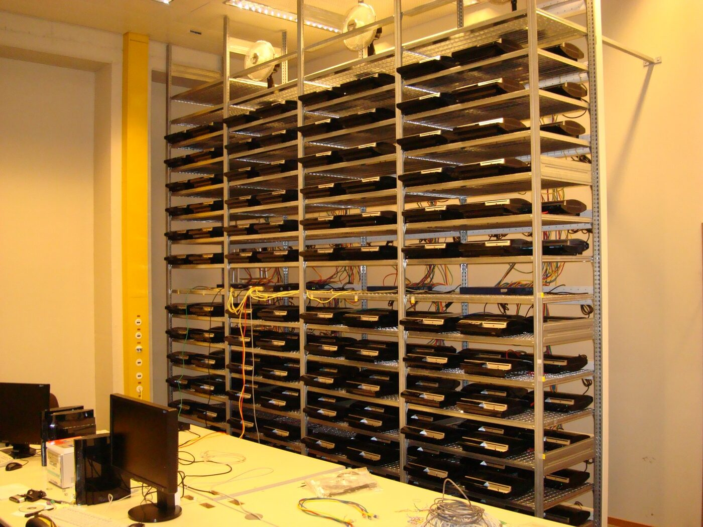

    Exemple surprenant : de véritables **clusters de PlayStation 3** ont été
    construits entre 2007 et 2010, grâce au processeur Cell d'IBM.

## 2005 – aujourd'hui : du multi-cœur au manycore

Pendant des décennies, les processeurs gagnent en vitesse grâce à
l'augmentation de leur **fréquence**. Vers 2005, ce progrès s'arrête :
au-delà de 3 à 4 GHz, la puce consomme et chauffe trop. C'est le **mur de
la fréquence** (*power wall*).

Les constructeurs utilisent alors les transistors supplémentaires pour
placer **plusieurs cœurs** sur une même puce :

- **2005 :** les premiers processeurs grand public à deux cœurs ;
- **années 2010 :** des processeurs de serveur à plusieurs dizaines de
  cœurs ;
- **architectures *manycore* :** des puces conçues pour le calcul, avec un
  très grand nombre de cœurs plus simples, comme l'Intel Xeon Phi (jusqu'à
  72 cœurs) ou le Fujitsu A64FX (48 cœurs) du super-calculateur japonais
  Fugaku ;
- **aujourd'hui :** les processeurs de serveur dépassent la centaine de
  cœurs.

!!! warning "La fin des accélérations gratuites"

    Tant que la fréquence augmentait, un programme séquentiel devenait plus
    rapide à chaque nouvelle génération de processeurs, sans être modifié.
    Avec le multi-cœur, ce n'est plus le cas : seul un programme
    **parallèle** profite des cœurs supplémentaires.

-   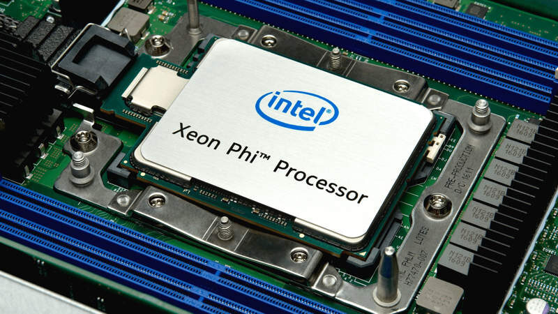

    **Intel Xeon Phi KNL** (2016)

    72 cœurs3 Tflop/s200 W

-   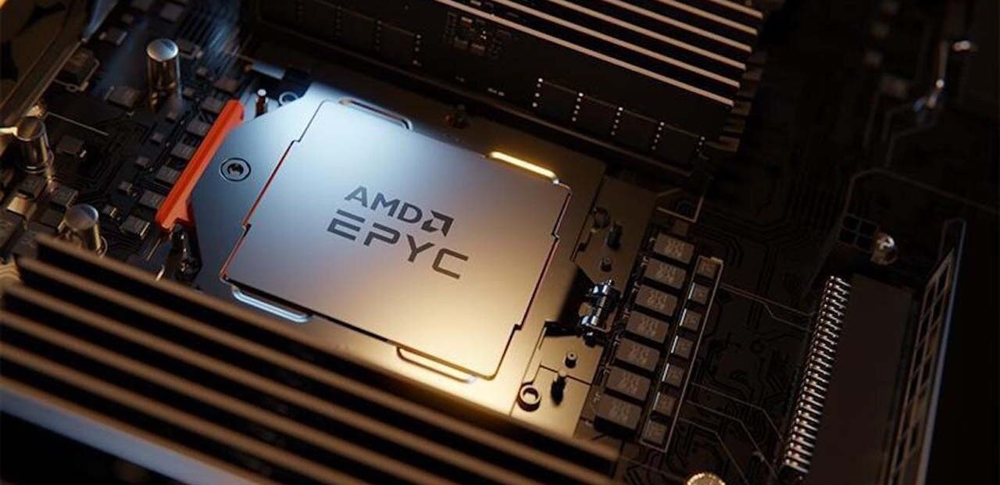

    **AMD Epyc Genoa** (2022)

    96 cœurs8 Tflop/s400 W

## 2010 – aujourd'hui : le retour de la vectorisation

Les machines Cray des années 1970-1990 étaient **vectorielles** : une
instruction s'appliquait à tout un vecteur de nombres. Cette idée revient
au cœur des processeurs modernes, sous la forme d'unités **SIMD** (*Single
Instruction, Multiple Data*) : une seule instruction traite plusieurs
nombres à la fois. Le principe est celui
des Cray, présenté plus haut : un processeur AVX, par exemple, additionne 4
nombres en double précision en une seule instruction.

| Jeu d'instructions | Année | Taille des vecteurs | Nombres en double précision par instruction |
|---|---|---|---|
| SSE (Intel, AMD) | 1999 | 128 bits | 2 |
| AVX (Intel, AMD) | 2011 | 256 bits | 4 |
| AVX-512 (Intel, puis AMD) | 2016 | 512 bits | 8 |
| SVE (ARM, Fujitsu A64FX) | 2020 | de 128 à 2 048 bits (512 sur l'A64FX) | jusqu'à 32 |

La vectorisation pèse lourd dans la puissance d'un processeur. Sa
**puissance crête** est le produit :

\[
\text{cœurs} \times \text{fréquence} \times \text{opérations par cycle et par cœur}
\]

Pour l'Intel Xeon Phi KNL : 72 cœurs à 1,4 GHz, avec deux unités AVX-512
par cœur qui effectuent chacune 8 multiplications-additions (soit 16
opérations) par cycle, donnent \(72 \times 1{,}4 \times 10^9 \times 32
\approx 3{,}2\) Tflop/s. Sans la vectorisation, cette puissance serait
divisée par 8.

!!! info "Qui vectorise ?"

    Le plus souvent, c'est le **compilateur** qui transforme
    automatiquement les boucles simples en instructions vectorielles. En
    Python, les opérations NumPy sur des tableaux entiers s'exécutent dans
    des boucles compilées et vectorisées, ce qui explique leur rapidité par
    rapport à une boucle Python.

## 2010 : l'émergence des accélérateurs GPU

La technologie **GPU** offre, pour du calcul pur, de meilleurs ratios
performance / prix / consommation électrique que les CPU. Beaucoup des
super-calculateurs les plus puissants du monde l'utilisent.

!!! info "Accélérateur"

    Les GPU sont des **accélérateurs** : ils complètent le CPU, ils ne le
    remplacent pas.

### Pourquoi calculer sur des GPU ?

Un GPU (*Graphics Processing Unit*) est conçu pour calculer l'image
affichée à l'écran : il applique **le même calcul à des millions de pixels**,
indépendamment les uns des autres. C'est exactement du parallélisme de
données, comme dans une simulation où l'on met à jour chaque maille d'une
grille.

--8<-- "introduction/cpu-gpu.svg"

| | CPU | GPU |
|---|---|---|
| Unités de calcul | Quelques dizaines de cœurs complexes | Des milliers d'unités simples |
| Optimisé pour | La **latence** : exécuter vite une suite d'instructions, avec des branchements | Le **débit** : effectuer le plus d'opérations possible en parallèle |
| Bande passante mémoire | Élevée | Plusieurs fois plus élevée |
| Efficacité énergétique | Bonne | Bien meilleure, en flop/s par watt, sur du calcul régulier |

Plusieurs raisons ont poussé les scientifiques à essayer les GPU :

- **La puissance brute :** dès le milieu des années 2000, une carte
  graphique offre plus de flop/s qu'un processeur, d'abord en simple
  précision. La double précision, indispensable à la simulation, ne
  devient performante sur GPU qu'autour de 2010.
- **Le prix :** produites en masse pour le jeu vidéo, les cartes
  graphiques sont bon marché pour leur puissance.
- **La consommation :** pour le même calcul, elles consomment moins
  d'énergie, ce qui devient la contrainte principale des super-calculateurs.

Les premières **expériences** datent du début des années 2000 : des
chercheurs détournent le pipeline graphique, en déguisant leurs calculs en
opérations de rendu d'images (*shaders*). On parle alors de **GPGPU**
(*General-Purpose computing on GPU*). Les résultats sont prometteurs, mais
la programmation est très laborieuse.

!!! warning "Les limites des GPU"

    Les GPU ne sont efficaces que pour des calculs **réguliers et
    massivement parallèles**. Les codes avec beaucoup de branchements ou
    peu de parallélisme s'y prêtent mal. Et les données doivent être
    copiées entre la mémoire du CPU et celle du GPU, ce qui a un coût.

### De la carte graphique au super-calculateur

Les GPU, conçus pour l'affichage, deviennent programmables pour le calcul
généraliste avec l'arrivée de **CUDA** en 2007. NVIDIA lance alors sa gamme
**Tesla**, des cartes dédiées au calcul, sans sortie vidéo. En quelques
années, elles s'imposent dans les plus grandes machines :

- **2010 :** le super-calculateur chinois **Tianhe-1A** devient le premier
  n°1 du TOP500 accéléré par des GPU (NVIDIA Tesla M2050).
- **2012 :** **Titan**, aux États-Unis, prend la première place avec
  18 688 GPU NVIDIA Tesla K20X.

-   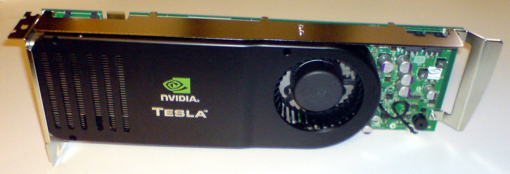{ .on-white }

    **Carte NVIDIA Tesla** (2007-2008)

    1re générationsans sortie vidéo

-   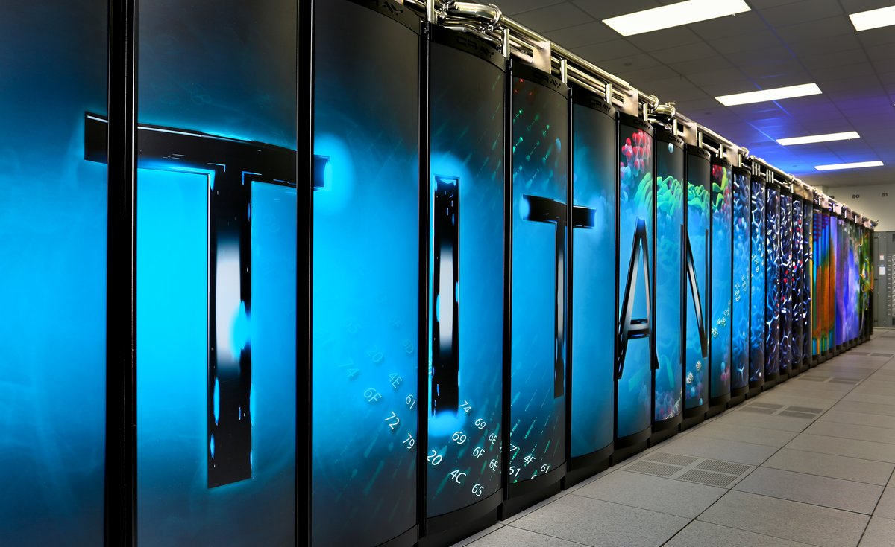

    **Titan** (2012), n°1 du TOP500

    18 688 GPU17,6 Pflop/s

Dix ans plus tard, un seul GPU dépasse la puissance de plusieurs dizaines
de cartes de cette époque :

-   { .on-white }

    **NVIDIA A100** (2020)

    10 Tflop/s250 W

-   { .on-white }

    **AMD MI250** (2021)

    45 Tflop/s500 W

Les puissances indiquées sont en double précision.

<small>Crédits photo (Wikimedia Commons) : carte Tesla, domaine public ;
Titan, Oak Ridge National Laboratory, CC BY 2.0.</small>

## 2020: La course à l'exascale

Une compétition mondiale vise à atteindre la puissance de \(10^{18}\)
opérations par seconde en double précision (**1 Eflop/s**) dans une
enveloppe énergétique d'environ 20 MW.

### Les GPU, clés de l'exascale

Avec des processeurs classiques, une machine exaflopique aurait consommé
bien plus que les 20 MW visés. Ce sont les **GPU**, qui offrent beaucoup
plus de flop/s par watt, qui ont permis de franchir ce seuil dans une
enveloppe énergétique raisonnable. Les premières machines exascale tirent
ainsi l'essentiel de leur puissance de leurs accélérateurs :

| Machine | Pays | Mise en service | Accélérateurs | Performance (HPL) |
|---|---|---|---|---|
| **Frontier** | États-Unis | 2022 | GPU AMD MI250X | 1,35 Eflop/s |
| **Aurora** | États-Unis | 2024 | GPU Intel Data Center Max | 1,01 Eflop/s |
| **El Capitan** | États-Unis | 2024 | APU AMD MI300A (CPU et GPU dans un même boîtier) | 1,81 Eflop/s |
| **JUPITER** | Allemagne | 2025 | NVIDIA GH200 Grace Hopper | 1,00 Eflop/s |

Le seuil a été franchi pour la première fois en 2022, par **Frontier**.

!!! note "Une exception : LineShine"

    Depuis juin 2026, la première place du TOP500 est occupée par
    **LineShine** (Shenzhen, Chine), avec 2,2 Eflop/s, un système qui
    n'utilise **que des CPU**. Il montre que d'autres architectures restent
    possibles, au prix d'un très grand nombre de cœurs (près de 14 millions)
    et d'une consommation d'environ 42 MW.

<figure markdown>
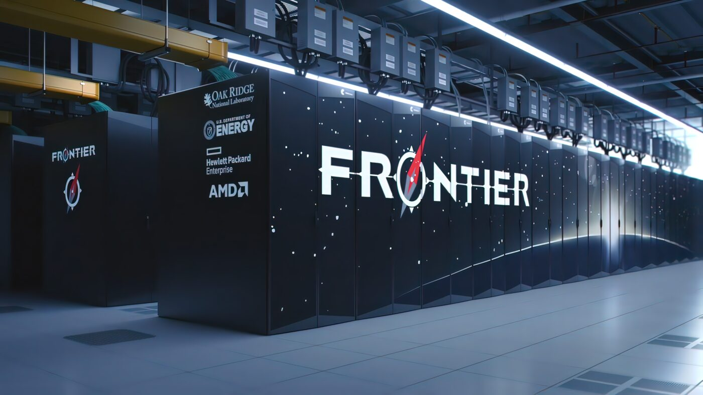
<figcaption><strong>Frontier</strong> (USA), premier super-ordinateur à atteindre une puissance exaflopique : \(10^{18}\) opérations par seconde en double précision.</figcaption>
</figure>

### Les machines européennes

L'Europe finance ses super-calculateurs les plus puissants à travers
l'**entreprise commune EuroHPC** (*EuroHPC Joint Undertaking*), qui associe
l'Union européenne et les États membres. Toutes ses grandes machines
récentes reposent sur des GPU.

| Machine | Pays (site) | Mise en service | Accélérateurs | Performance (HPL) |
|---|---|---|---|---|
| **JUPITER** | Allemagne (Jülich) | 2025 | NVIDIA GH200 | 1,00 Eflop/s |
| **Alice Recoque** | France (TGCC, Bruyères-le-Châtel) | 2027 | AMD Instinct MI430X | plus de 1 Eflop/s (prévu) |
| **LUMI** | Finlande (Kajaani) | 2022 | AMD MI250X | 380 Pflop/s |
| **Leonardo** | Italie (Bologne) | 2022 | NVIDIA A100 | 241 Pflop/s |
| **MareNostrum 5** | Espagne (Barcelone) | 2023 | NVIDIA H100 | 175 Pflop/s |
| **Alps** | Suisse (Lugano, hors EuroHPC) | 2024 | NVIDIA GH200 | 435 Pflop/s |

- **JUPITER** est le **premier super-calculateur exascale européen** : il a
  atteint 1 Eflop/s en novembre 2025, et c'est la machine exascale la plus
  efficace énergétiquement.
- **Alice Recoque** sera la **deuxième machine exascale européenne**, et la
  première en France. Elle porte le nom d'une pionnière française de
  l'informatique et de l'intelligence artificielle.
- **LUMI, Leonardo et MareNostrum 5** sont les machines *pré-exascale*
  financées par EuroHPC avant elles.

<figure markdown>
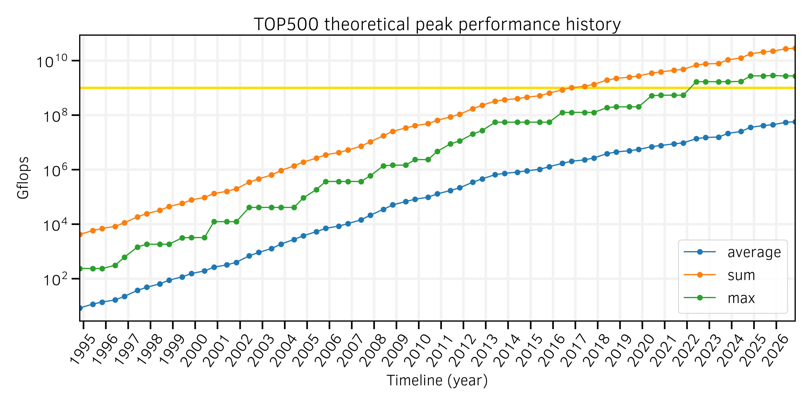{ .on-white }
<figcaption>Évolution de la puissance mesurée dans le TOP500 (moyenne, somme et maximum), en Gflop/s, échelle logarithmique.</figcaption>
</figure>

<figure markdown>
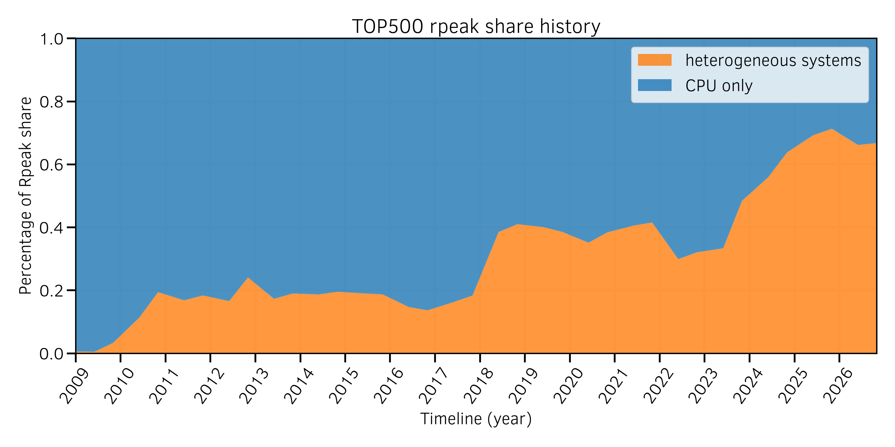{ .on-white }
<figcaption>Évolution de la part des systèmes accélérés par des GPUs comparé aux systèmes purement CPU.</figcaption>
</figure>

## 2020 : l'émergence de l'IA

L'**apprentissage profond** (*deep learning*) repose sur des réseaux de
neurones dont l'entraînement se ramène, pour l'essentiel, à d'immenses
**produits de matrices** : exactement le type de calcul pour lequel les GPU
sont conçus.

- **2012 :** le réseau AlexNet, entraîné sur deux GPU de jeu vidéo,
  remporte un concours de reconnaissance d'images et lance la vague de
  l'apprentissage profond.
- **2020 :** les grands modèles de langage, comme GPT-3, montrent que les
  performances augmentent avec la taille du modèle et des données, donc
  avec la puissance de calcul.
- **2022 :** le succès de ChatGPT déclenche une course aux capacités de
  calcul. Les entreprises de l'IA construisent des centres de calcul de
  **dizaines, voire de centaines de milliers de GPU**.

Cette demande transforme le marché du calcul. Les GPU, longtemps des
accélérateurs réservés à certaines machines, deviennent la ressource
centrale des grands centres de calcul, et les constructeurs les conçoivent
d'abord pour l'IA.

### Des GPU pensés pour l'IA

L'IA tolère des calculs moins précis que la simulation numérique. Les GPU
récents intègrent donc des unités spécialisées (*tensor cores*) très
rapides en **précision réduite** : 16 ou même 8 bits, au lieu des 64 bits
de la double précision utilisée en simulation.

| NVIDIA H100 (2022) | Puissance de calcul (d'après la fiche technique) |
|---|---|
| Double précision (FP64, 64 bits) | 67 Tflop/s |
| Demi-précision (FP16, 16 bits) | environ 1 000 Tflop/s |
| FP8 (8 bits) | environ 2 000 Tflop/s |

!!! warning "Des flop/s qui ne se comparent pas"

    Les performances annoncées pour l'IA sont souvent données en précision
    réduite. Elles ne sont pas comparables à celles du TOP500, mesurées en
    double précision : un même GPU affiche environ 30 fois plus de flop/s
    en FP8 qu'en FP64.

### Les conséquences pour le calcul scientifique

- **Des machines dominées par les GPU.** La plupart des nouveaux
  super-calculateurs, y compris les machines exascale, tirent l'essentiel
  de leur puissance de GPU. Les codes de simulation doivent être adaptés
  pour les exploiter.
- **La précision mixte.** Certains codes utilisent la précision réduite
  pour les parties qui le tolèrent, afin de profiter de ces unités très
  rapides.
- **L'IA pour la science.** L'IA devient un outil de la simulation : des
  modèles entraînés remplacent des parties coûteuses d'un calcul, ou
  prédisent directement un résultat, comme la structure des protéines avec
  AlphaFold.
- **L'énergie.** Ces centres de calcul consomment des dizaines, voire des
  centaines de mégawatts : la consommation électrique devient une
  contrainte majeure, pour l'IA comme pour le HPC.

## Et demain ? De nouveaux accélérateurs

Après les processeurs vectoriels, le parallélisme massif et les GPU,
l'histoire du HPC continue de chercher **plus de calcul pour moins
d'énergie**. Plusieurs pistes coexistent, souvent portées par les besoins
de l'IA.

### Des circuits spécialisés

| Type | Principe | Exemples |
|---|---|---|
| **FPGA** | Circuit **reprogrammable** : on configure le matériel lui-même pour un calcul précis. Très efficace énergétiquement pour certains traitements, mais difficile à programmer | Cartes AMD (Xilinx) et Intel (Altera) ; une partition FPGA est prévue dans Alice Recoque |
| **Accélérateurs reconfigurables à flot de données** (*dataflow*) | La puce se reconfigure pour suivre le **graphe des opérations** du programme : les données circulent d'une unité de calcul à l'autre, sans passer par une suite d'instructions. Le compilateur part du code existant (C, C++, Fortran, Python), sans réécriture | NextSilicon Maverick-2, orienté HPC (double précision), en test au Sandia (machine Spectra) et au Los Alamos National Laboratory |
| **TPU** et autres puces pour l'IA | Circuit **dédié** aux produits de matrices et aux réseaux de neurones, sans la polyvalence d'un GPU | TPU de Google (depuis 2015), Cerebras (une puce de la taille d'une plaquette de silicium entière), Groq, Graphcore |
| **APU et puces CPU + GPU** | CPU et GPU sont réunis dans un même boîtier et accèdent à la même mémoire : plus besoin de copier les données de l'un à l'autre. AMD parle d'**APU** (*Accelerated Processing Unit*) | APU AMD MI300A (El Capitan), dont les cœurs CPU et GPU partagent la même mémoire HBM ; NVIDIA Grace Hopper (JUPITER, Alps), un CPU et un GPU reliés sur un même module |
| **Processeurs ARM et RISC-V** | Architectures de CPU plus sobres, ouvertes ou sous licence, alternatives aux processeurs x86 | Fugaku (Japon, ARM) ; processeur européen SiPearl Rhea, prévu dans Alice Recoque |

### Des approches plus lointaines

Calcul quantique
:   Un ordinateur quantique ne remplace pas un super-calculateur, mais
    pourrait l'**accélérer** pour certains problèmes (chimie, optimisation).
    EuroHPC installe ainsi des ordinateurs quantiques dans des centres de
    calcul européens, couplés aux super-calculateurs.

Calcul neuromorphique
:   Des puces inspirées du fonctionnement du cerveau, comme Loihi d'Intel,
    qui visent une très faible consommation pour certaines tâches d'IA.
