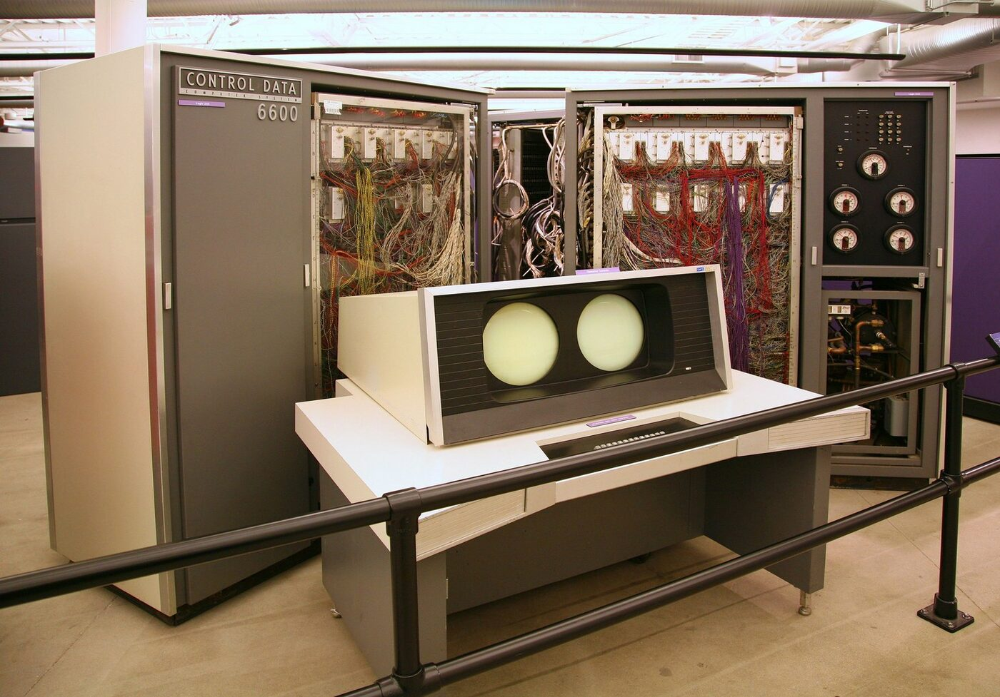
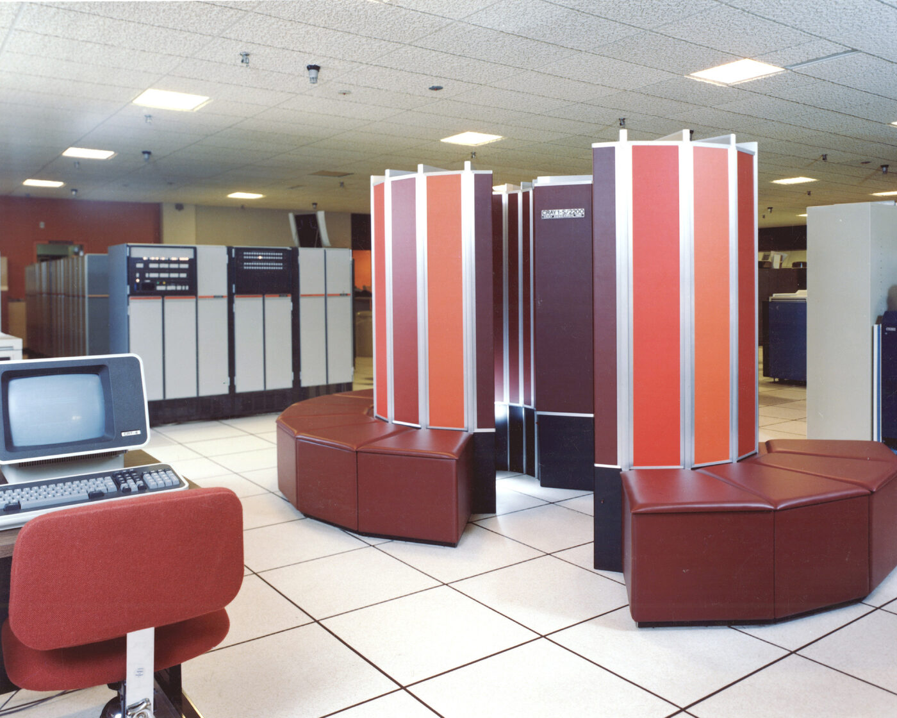
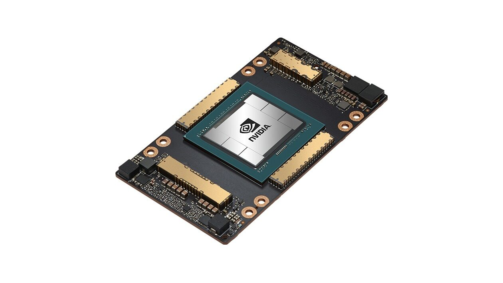
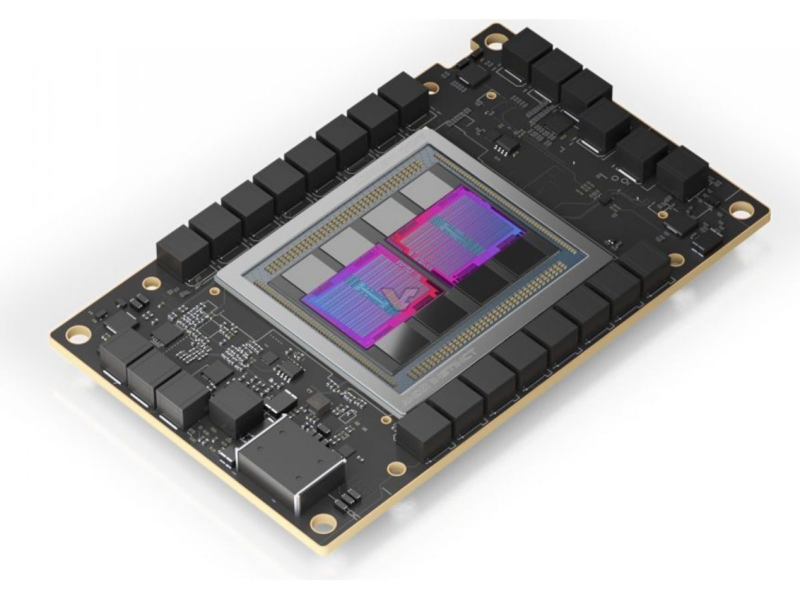
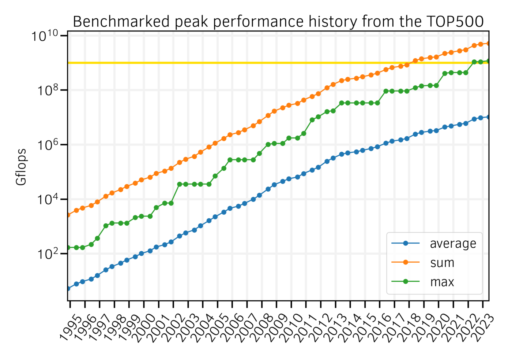

# 2. Un peu d'histoire

Pour mesurer le chemin parcouru, certaines machines sont comparées à un appareil
que vous connaissez bien : votre smartphone.

## 1940 – 1960 : les prémices

L'histoire des ordinateurs démarre doucement un peu avant la Seconde Guerre
mondiale, et voit ses premiers systèmes appliqués (électromécaniques ou
électroniques) pendant la guerre.

**ENIAC** (1945), l'un des premiers ordinateurs électroniques.

🇺🇸 USA50 kflop/s150 kW

## 1960 – 1970 : la naissance d'une industrie

Les super-ordinateurs destinés au calcul scientifique au sens propre
émergent au début des années 60. C'est aussi la naissance du **Fortran**.

**CDC 6600** (1964), l'un des premiers vrais succès du HPC.

🇺🇸 USA0,5 Mflop/s30 kW

## 1970 – 1990 : l'ère des machines vectorielles et de Cray

Seymour Cray, l'un des concepteurs du CDC 6600, fonde sa propre société,
qui devient l'un des leaders du marché pendant 15 ans.

Les Cray utilisent un **processeur vectoriel** : le même calcul est
effectué en même temps sur tous les éléments d'un vecteur de données.

-   

    **Cray-1** (1975) — vectorisation très efficace, à la fois esthétique
    et performant.

    🇺🇸 USA160 Mflop/s115 kW📱 ≈ iPhone 1

-   

    **Cray Y-MP** (1988) — 2 à 8 processeurs vectoriels à mémoire
    partagée, 333 Mflop/s par processeur.

    🇺🇸 USA2,6 Gflop/s📱 ≈ iPhone 5

## 1990 – aujourd'hui : le parallélisme massif distribué

D'un point de vue économique et technique, il devient de plus en plus
intéressant de **mettre en réseau des processeurs issus du grand public**.
On utilise des processeurs de la micro-informatique légèrement adaptés au
monde du HPC, ce qui permet :

- l'homogénéisation des outils de développement ;
- l'abaissement des coûts de R&D et de production ;
- le retour au processeur **scalaire** (une opération sur une donnée).

-   

    **CM-5** (1993) — 1024 processeurs, premier du TOP500 en 1993.

    🇺🇸 USA131 Gflop/s📱 ≈ iPhone 7

-   

    Exemple surprenant : de véritables **clusters de PlayStation 3** ont été
    construits entre 2007 et 2010, grâce au processeur Cell d'IBM.

## 2010 – aujourd'hui : le retour de la vectorisation et du multi-cœur

Les processeurs deviennent **multi-cœurs** et redeviennent **vectoriels**,
comme l'étaient les machines Cray. Quelques exemples de processeurs
modernes utilisés en HPC :

-   

    **Intel Xeon Phi KNL** (2016)

    72 cœurs3 Tflop/s200 W

-   

    **AMD Epyc Genoa** (2022)

    96 cœurs8 Tflop/s400 W

## 2010 – aujourd'hui : l'émergence des accélérateurs GPU

La technologie **GPU** offre, pour du calcul pur, de meilleurs ratios
performance / prix / consommation électrique que les CPU. Beaucoup des
super-calculateurs les plus puissants du monde l'utilisent.

!!! info "Accélérateur"

    Les GPU sont des **accélérateurs** : ils complètent le CPU, ils ne le
    remplacent pas.

-   { .on-white }

    **NVIDIA A100**

    10 Tflop/s250 W

-   { .on-white }

    **AMD MI250**

    45 Tflop/s500 W

## La course à l'exascale

Une compétition mondiale vise à atteindre la puissance de \(10^{18}\)
opérations par seconde en double précision (**1 Eflop/s**) dans une
enveloppe énergétique de 20 MW.

- Ce seuil a été franchi pour la première fois par les États-Unis en 2022
  avec **Frontier**.
- L'Europe se dote à son tour de machines exascale dans le cadre de
  l'initiative EuroHPC.
  <!-- TODO : actualiser (JUPITER en Allemagne, Alice Recoque en France) -->

<figure markdown>
{ .on-white }
<figcaption>Évolution de la puissance mesurée dans le TOP500 (moyenne, somme et maximum), en Gflop/s, échelle logarithmique.</figcaption>
</figure>

<figure markdown>

<figcaption><strong>Frontier</strong> (USA), premier super-ordinateur à atteindre une puissance exaflopique : \(10^{18}\) opérations par seconde en double précision.</figcaption>
</figure>

## Testez-vous

??? question "Qu'est-ce qu'un processeur vectoriel ?"

    Un processeur qui applique la **même opération** à tous les éléments
    d'un vecteur de données **en même temps**, au lieu de traiter un
    élément après l'autre (processeur scalaire).

??? question "Pourquoi les super-calculateurs utilisent-ils depuis les années 90 des processeurs issus du grand public ?"

    Pour des raisons économiques et techniques : coûts de R&D et de
    production réduits, et outils de développement communs avec le reste
    de l'informatique.
