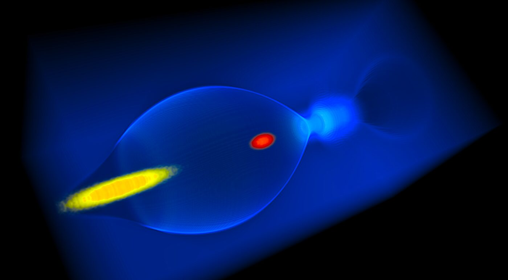

# I. Introduction au calcul parallèle

Ce premier chapitre pose le décor : à quoi sert la simulation numérique,
pourquoi elle a besoin de super-calculateurs, d'où viennent ces machines
et comment elles sont organisées.

## Objectifs

À la fin de ce chapitre, vous saurez :

- expliquer ce qu'est le **Calcul Haute Performance** (HPC) et à quoi il sert ;
- estimer un **ordre de grandeur** de temps de calcul et comprendre ce
  qu'est un flop/s ;
- situer les grandes étapes de l'**histoire** des super-calculateurs ;
- distinguer **mémoire distribuée** et **mémoire partagée**, et relier ces
  notions aux modèles de programmation **MPI** et **OpenMP**.

## Plan du chapitre

-   __1. Qu'est-ce que le HPC ?__

    ---

    Usages de la simulation numérique, définitions, métiers, puissance de
    calcul et TOP500.

    [:octicons-arrow-right-24: Lire](qu-est-ce-que-le-hpc.md)

-   __2. Un peu d'histoire__

    ---

    De l'ENIAC à Frontier : machines vectorielles, parallélisme massif,
    GPU et course à l'exascale.

    [:octicons-arrow-right-24: Lire](histoire.md)

-   __3. Fonctionnement d'un super-calculateur__

    ---

    Nœuds, réseau, architectures mémoire, langages et modèles de
    programmation parallèle.

    [:octicons-arrow-right-24: Lire](fonctionnement.md)

