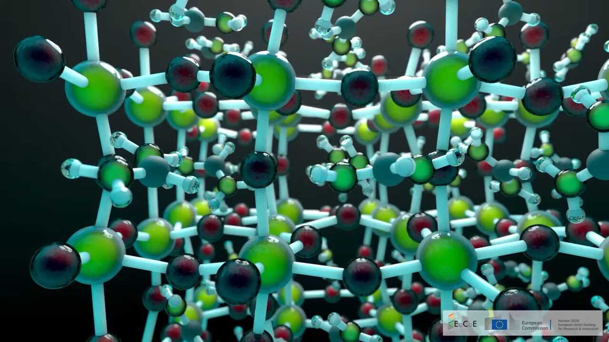
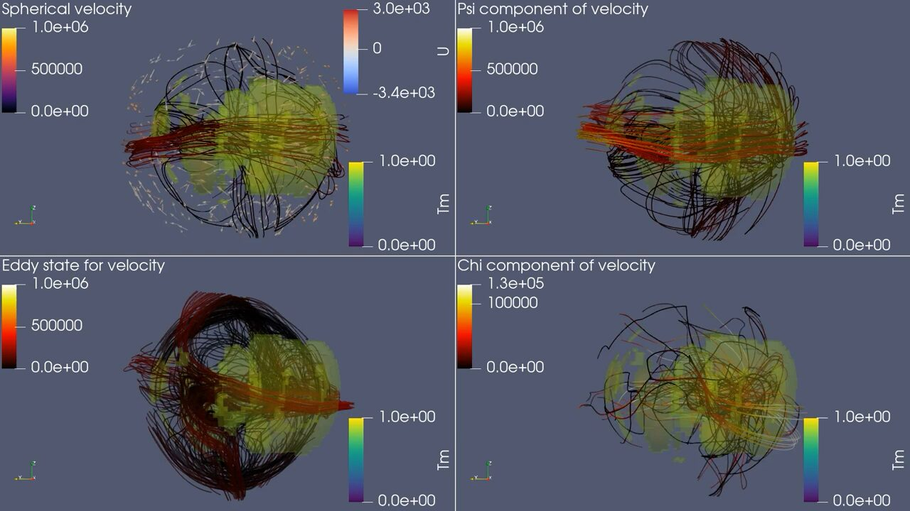
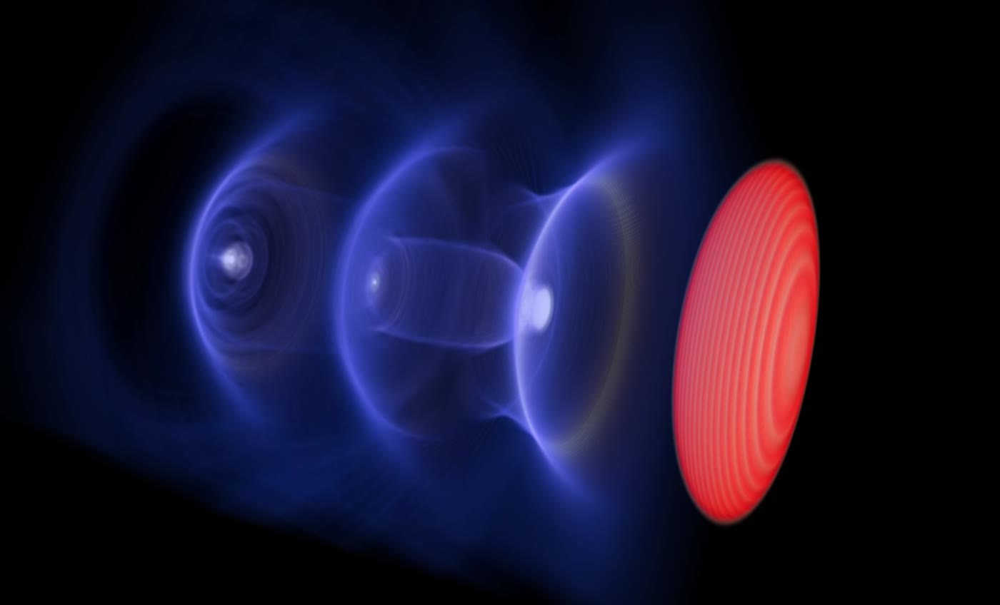
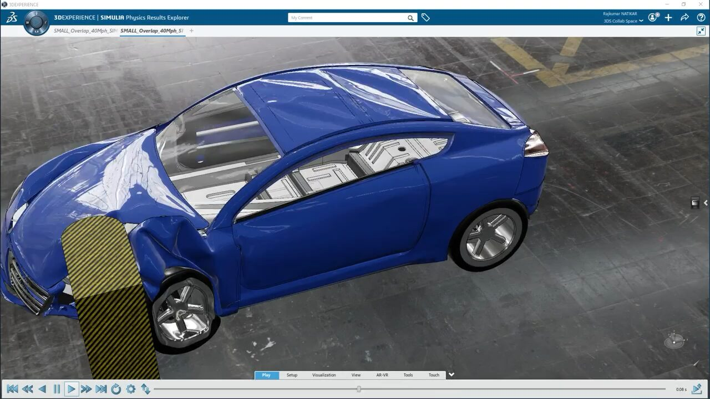
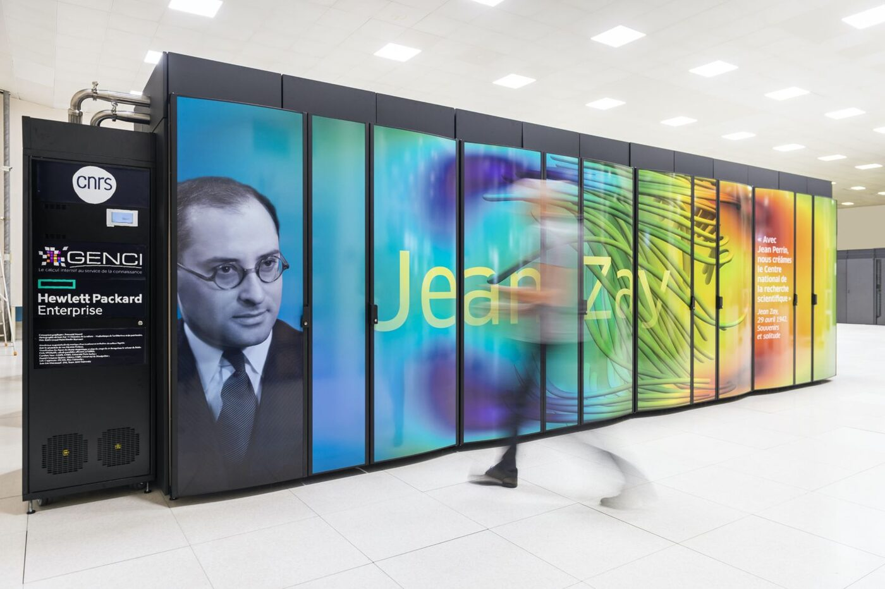
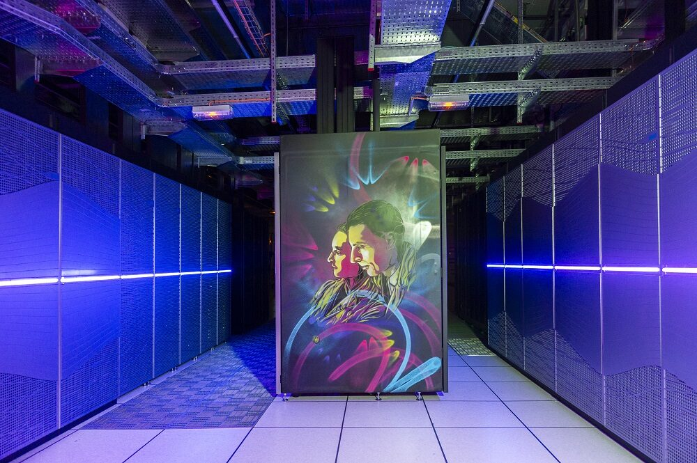
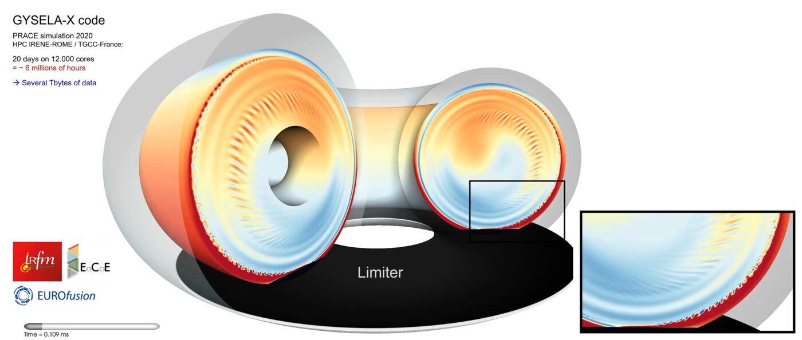
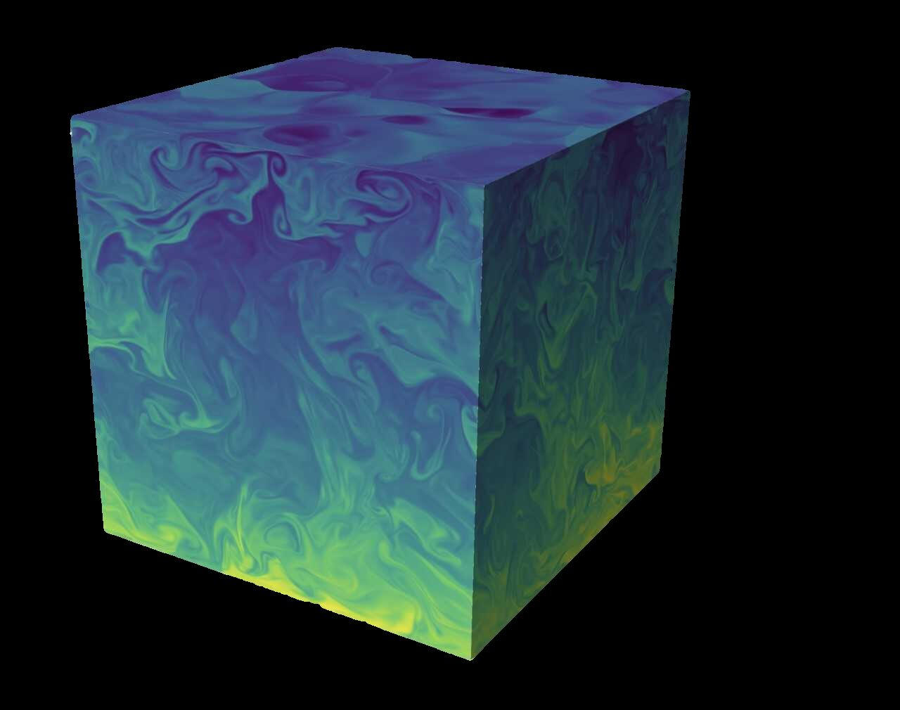
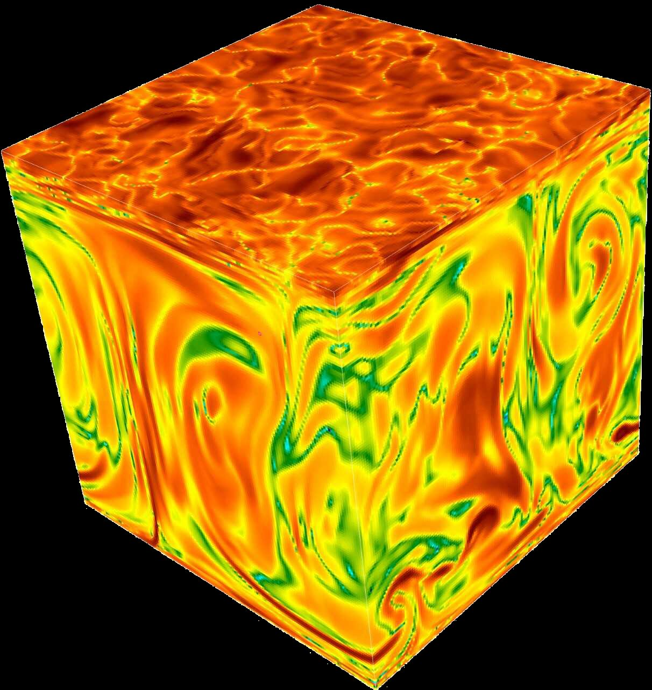
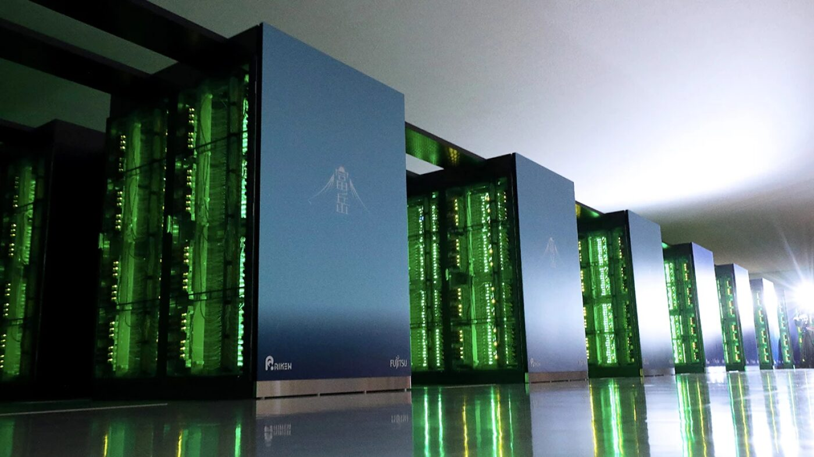

# 1. Qu'est-ce que le Calcul Haute Performance ?

## La simulation numérique

La **simulation numérique** utilise la physique, les mathématiques
appliquées et l'informatique pour résoudre des problèmes scientifiques.

<figure markdown>

<figcaption>La simulation numérique au service de la chimie et des matériaux.</figcaption>
</figure>

Elle partage des outils avec d'autres domaines qui, eux, ne cherchent pas
forcément à reproduire fidèlement la réalité :

<figure markdown>

<figcaption>Le <strong>jeu vidéo</strong> est une approximation du réel avec des contraintes artistiques, de jouabilité et de rendu en temps réel.</figcaption>
</figure>

<figure markdown>

<figcaption>L'<strong>animation et les effets spéciaux</strong> recherchent un rendu artistique et l'illusion du réel.</figcaption>
</figure>

### À quoi sert la simulation numérique ?

=== "Prédire"

    La simulation numérique est utilisée pour **prédire le futur** à
    partir de paramètres présents : météorologie, climatologie, économie,
    sociologie…

    <figure markdown>
    
    </figure>

=== "Explorer"

    Elle permet d'**aller là où l'humain, les caméras ou les sondes ne
    peuvent pas aller** : astrophysique, physique de l'extrêmement petit,
    intérieur des plasmas…

    <figure markdown>
    
    </figure>

=== "Concevoir"

    Elle sert à **concevoir et optimiser** des expériences ou de nouveaux
    produits : voitures, avions…

    <figure markdown>
    
    </figure>

=== "Remplacer des expériences"

    Elle permet de **remplacer des expériences coûteuses** et de les
    répéter à volonté : crash-tests, optimisation de produits…

    <figure markdown>
    
    <figcaption>Source : <a href="https://www.youtube.com/watch?v=LBMIzr0aPI8">YouTube</a></figcaption>
    </figure>

## Pourquoi un super-calculateur ? L'exemple d'une goutte d'eau

Imaginons que l'on souhaite simuler une simple **goutte d'eau**.

- Il faut calculer la trajectoire d'environ \(10^{21}\) molécules d'eau.
- Supposons qu'il faille **une opération** informatique par molécule et
  par pas de temps.
- Un ordinateur de bureau véloce réalise environ \(10^{12}\) opérations
  à virgule flottante par seconde.

Le temps de calcul est alors :

\[
t = \frac{10^{21}\ \text{opérations}}{10^{12}\ \text{opérations/s}}
  = 10^{9}\ \text{s} \approx 30\ \text{ans}
\]

!!! warning "Conclusion"

    Pour la plupart des problèmes scientifiques et industriels actuels,
    l'utilisation d'un **super-calculateur** devient nécessaire.

<figure markdown>

<figcaption>Le super-calculateur Jean Zay à l'IDRIS (France).</figcaption>
</figure>

## Définitions

Super-calculateur
:   Un super-calculateur (ou super-ordinateur) est un ordinateur d'une
    puissance largement supérieure à celle d'un ordinateur de bureau.
    Aujourd'hui, ce sont de grosses armoires (comme dans un data-center)
    qui connectent, au travers d'un réseau extrêmement rapide, un très
    grand nombre d'unités de calcul (processeurs, GPU). On parle de
    **machine massivement parallèle**.

Calcul Haute Performance (HPC)
:   Discipline qui s'intéresse à la programmation et à l'utilisation des
    super-calculateurs dans le but d'exécuter de la manière la plus
    performante possible des algorithmes donnés. Le HPC joue un rôle
    essentiel en simulation numérique en permettant l'élaboration de
    codes, principalement scientifiques, capables de tourner efficacement
    sur de très grands super-ordinateurs. On utilise souvent
    l'abréviation anglaise **HPC** (*High Performance Computing*).

<figure markdown>

<figcaption>Le super-calculateur Joliot-Curie au CEA (TGCC).</figcaption>
</figure>

## Deux exemples de simulations

<figure markdown>

<figcaption>Simulation <strong>Gysela-X</strong> d'un plasma de tokamak : 20 jours sur 12 000 cœurs AMD Rome (TGCC). Elle aurait pris 10 ans sur un ordinateur de bureau.</figcaption>
</figure>

**Convection dans l'atmosphère d'exoplanètes.** Simulation réalisée avec
le code ARK (volumes finis, MPI + Kokkos) sur GPU NVIDIA V100, lors d'un
grand challenge sur le super-calculateur Jean Zay par Simon Daley-Yates
([arXiv:2106.08842](https://arxiv.org/abs/2106.08842)). Elle aurait pris
**14 ans** sur un ordinateur de bureau.

## Pourquoi des super-calculateurs ?

Pour résoudre des problèmes **inaccessibles** avec la puissance de calcul
ou la mémoire d'un simple ordinateur. En science, il s'agit de :

- résoudre des problèmes avec beaucoup d'éléments ou sur des temps très longs ;
- effectuer un grand nombre de simulations (étude paramétrique, ensembles) ;
- résoudre des problèmes multi-dimensionnels complexes ;
- résoudre des problèmes multi-physiques ;
- traiter des données issues d'expériences (accélérateurs, satellites…).

Les choix technologiques et l'architecture d'un super-calculateur
dépendent avant tout de son **usage final** : calcul scientifique,
traitement des données, IA, temps réel…

<figure markdown>

<figcaption><strong>Fugaku</strong> (Japon), l'un des super-ordinateurs les plus puissants du monde (416 Pflop/s), équipé de processeurs ARM Fujitsu A64FX.</figcaption>
</figure>

## Les métiers du HPC

- **R&D** faisant appel à la modélisation numérique : ingénieur calcul, CFD, matériaux, chimie…
- **Recherche** faisant appel à la modélisation numérique : CFD, astrophysique, fusion, chimie, biologie…
- **Prédiction / statistique** : finance, assurance…
- **Traitement des données** (*big data*)
- **Intelligence artificielle** (*machine learning*, *deep learning*)
- **Rendu physique** pour l'animation
- **Optimisation** dans le jeu vidéo

{ .on-white }

## Notion de puissance de calcul

La puissance de calcul d'une unité de calcul, ou d'un ordinateur entier,
se mesure en **opérations par seconde**. Pour des opérations à virgule
flottante, on parle de **flop/s** (*floating-point operations per
second*). Il faut préciser s'il s'agit de flottants en simple ou en double
précision ; le plus souvent, les chiffres sont donnés en **double
précision**.

| Préfixe | Puissance | Ordre de grandeur |
|---|---|---|
| Gflop/s | \(10^{9}\) | un cœur de processeur |
| Tflop/s | \(10^{12}\) | un ordinateur de bureau, un GPU |
| Pflop/s | \(10^{15}\) | un super-calculateur |
| Eflop/s | \(10^{18}\) | les plus grands super-calculateurs actuels |

- La **puissance théorique** (crête) est la somme des puissances de chaque
  unité de calcul.
- La **puissance réelle** est évaluée à l'aide de *benchmarks*.

Il existe un classement mondial des super-calculateurs les plus puissants :
le [**TOP500**](https://www.top500.org/).
