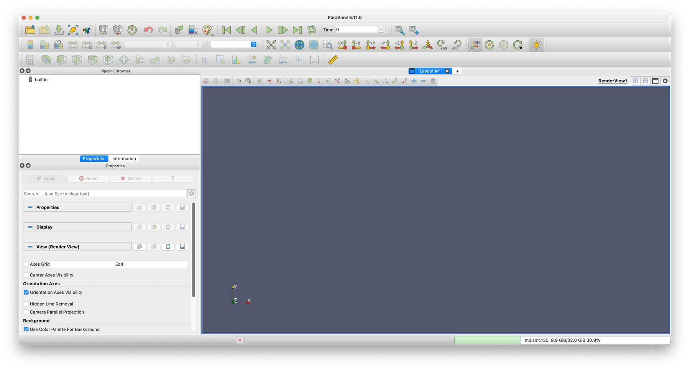
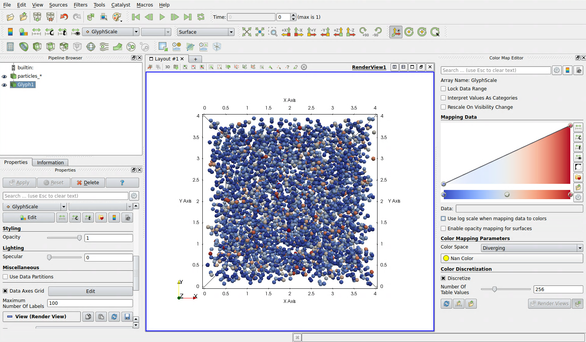
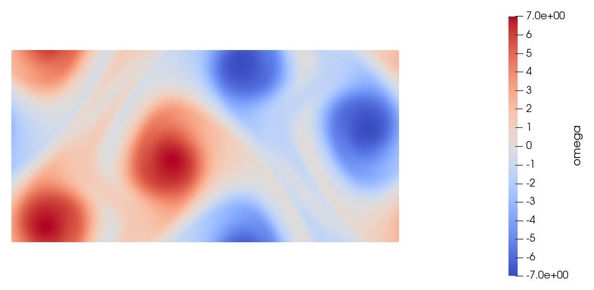
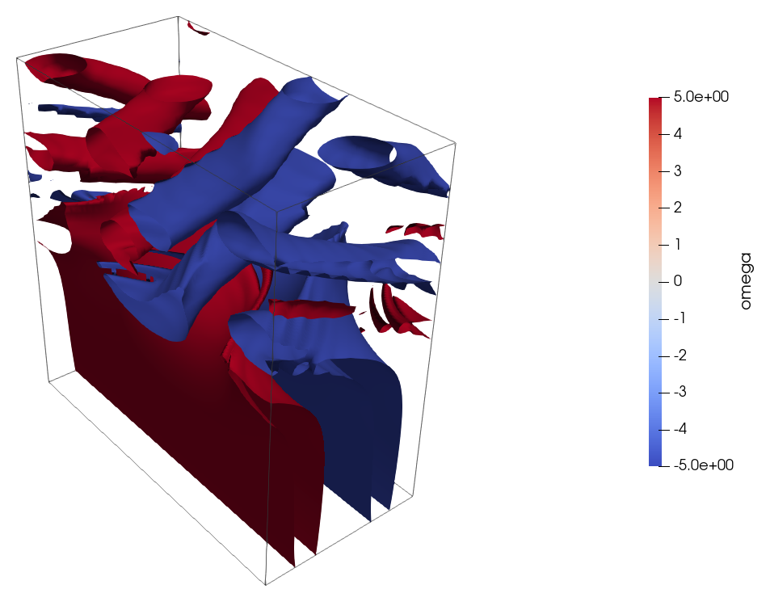

# VII. Visualisation avec ParaView

[ParaView](https://www.paraview.org/) est un logiciel libre de visualisation
de données scientifiques, développé par Kitware. Il est très utilisé en
calcul haute performance : il sait lire les formats des codes de simulation
et peut lui-même fonctionner en parallèle sur un super-calculateur.

Dans ce cours, il sert à visualiser en 3D :

- les fichiers `.vtk` du TP Mandelbulb ;
- les particules du TP Marble, écrites dans une série de fichiers `.vtk` ;
- l'évolution complète du TP Kelvin-Helmholtz, empilée en un volume
  (x, y, temps) par le script `stack.py`.

:material-laptop: L'installation est décrite à l'[étape 6 du guide d'installation](../installation.md#6-installer-paraview-facultatif).

## L'interface



Pipeline Browser (en haut à gauche)
:   La liste des données ouvertes et des filtres appliqués, sous forme
    d'arbre. L'icône en forme d'œil affiche ou masque chaque élément.

Properties (en bas à gauche)
:   Les paramètres de l'élément sélectionné dans le Pipeline Browser. Après
    toute modification, il faut cliquer sur **Apply** pour l'appliquer.

Vue de rendu (à droite)
:   L'affichage 3D. On tourne la scène avec le bouton gauche de la souris,
    on la déplace avec le bouton du milieu, et on zoome avec la molette ou
    le bouton droit.

Barres d'outils (en haut)
:   L'ouverture des fichiers, le choix du champ affiché et de sa palette de
    couleurs, les filtres les plus courants et le contrôle du temps pour
    les séries temporelles.

## Le principe du pipeline

ParaView fonctionne comme une **chaîne de traitements** (*pipeline*) :

1. un **lecteur** charge un fichier ;
2. des **filtres** transforment les données : coupe, isosurface, seuil… ;
3. chaque résultat est **affiché** dans la vue de rendu.

Un filtre s'applique à l'élément sélectionné dans le Pipeline Browser et
apparaît comme son enfant dans l'arbre. On peut ainsi enchaîner plusieurs
filtres, ou en appliquer plusieurs au même fichier.

!!! tip "Ne pas oublier Apply"

    Un filtre ou un fichier n'est calculé qu'après un clic sur **Apply**,
    dans le panneau Properties. C'est l'oubli le plus fréquent quand on
    débute : on ne voit rien s'afficher.

## Ouvrir des données

On ouvre un fichier avec *File → Open*. ParaView choisit le lecteur d'après
l'extension et demande parfois de confirmer.

| Format | Dans le cours | Remarque |
|---|---|---|
| `.vtk` | TP Mandelbulb, `stack.py --format vtk` | Format natif de ParaView |
| `.xdmf` + `.h5` | `stack.py` (format par défaut) | Choisir le lecteur *Xdmf Reader* ; les deux fichiers doivent rester dans le même dossier |
| `particles_0.vtk`, `particles_1.vtk`… | TP Marble | ParaView regroupe les fichiers numérotés en une série temporelle : les boutons de lecture parcourent le temps |
| `.csv` | Tableaux de résultats | Utile pour des courbes, avec une vue *Line Chart* |

## Colorier selon un champ

Une fois les données affichées, la barre d'outils permet de choisir le
**champ** utilisé pour la couleur (par exemple `omega`), puis :

- **Rescale** ajuste l'échelle de couleurs aux valeurs minimale et maximale
  du champ ;
- l'éditeur de palette (*Edit Color Map*) permet de choisir une palette
  prédéfinie, par exemple *Cool to Warm*, adaptée aux champs qui changent de
  signe comme la vorticité ;
- l'icône de légende affiche ou masque la barre de couleurs.

## Les filtres essentiels

| Filtre | Effet |
|---|---|
| **Slice** | Coupe les données par un plan |
| **Contour** | Isosurfaces (en 3D) ou isolignes (en 2D) : les points où un champ vaut une valeur donnée |
| **Clip** | Garde la partie des données d'un côté d'un plan |
| **Threshold** | Garde les cellules dont un champ est compris entre deux valeurs |
| **Calculator** | Calcule un nouveau champ à partir des champs existants, par exemple la norme de la vitesse |
| **Plot Over Line** | Trace un champ le long d'un segment, sous forme de courbe |
| **Glyph** | Représente chaque point par un objet (sphère, flèche…), par exemple les particules de Marble |

Ils sont accessibles par le menu *Filters*, par la barre d'outils, ou par
la recherche rapide : ++ctrl+space++ (++alt+space++ sous macOS), puis le nom
du filtre.

## Exemple : les particules du TP Marble

Le TP Marble écrit, à chaque itération, la position et les propriétés des
particules dans un fichier `particles_<itération>.vtk`.

1. Ouvrez les fichiers **en groupe** avec *File → Open* : ParaView les
   regroupe en une seule entrée `particles_*`. Cliquez sur **Apply**.
2. Appliquez le filtre **Glyph** pour représenter chaque particule par une
   sphère. Dans Properties :
    - *Glyph Type* : `Sphere` ;
    - *Scale Factor* : une petite valeur, par exemple `0.1` ;
    - *Glyph Mode* : `All Points`, pour afficher toutes les particules et
      pas seulement une sélection.
3. Coloriez selon l'énergie ou la masse des particules, et activez
   *Data Axes Grid* pour afficher les axes.
4. Les boutons de lecture, en haut, parcourent les itérations.



## Exemple : l'instabilité de Kelvin-Helmholtz

Le script `stack.py` du TP Kelvin-Helmholtz empile tous les snapshots en un
volume dont le troisième axe est le **temps**. Ouvrez `stack.xdmf`, puis :

=== "Une coupe à un instant"

    Appliquez un filtre **Slice** de normale Z (le temps), placé au dernier
    instant, puis coloriez selon `omega`. On retrouve le champ de vorticité
    à la fin de la simulation, avec les tourbillons formés par
    l'instabilité.

    

=== "Des isosurfaces dans le temps"

    Appliquez un filtre **Contour** sur `omega`, avec deux valeurs, par
    exemple −5 et 5, puis un filtre **Outline** pour voir les limites du
    volume. En bas du volume (au début de la simulation), on voit les deux
    couches de cisaillement ; en remontant dans le temps, elles s'enroulent
    en tourbillons.

    

## Sauvegarder son travail

| Action | Menu | Usage |
|---|---|---|
| Image | *File → Save Screenshot* | Une figure pour un rapport |
| Animation | *File → Save Animation* | Une vidéo ou une suite d'images d'une série temporelle |
| État | *File → Save State* (`.pvsm`) | Retrouver plus tard le même pipeline, avec les mêmes réglages |

## Automatiser avec Python

ParaView se pilote aussi par des scripts Python, avec la commande
`pvpython` fournie avec ParaView. C'est utile pour produire les mêmes
images à chaque simulation, ou pour travailler sur un super-calculateur
sans interface graphique.

Le menu *Tools → Start Trace* enregistre les actions faites dans
l'interface sous forme de script Python : c'est le moyen le plus simple
d'écrire un premier script. Par exemple, pour la coupe ci-dessus :

```python title="coupe.py"
from paraview.simple import *

# Lecture du volume produit par stack.py
volume = XDMFReader(FileNames=["stack.xdmf"])
volume.UpdatePipeline()
xmin, xmax, ymin, ymax, tmin, tmax = volume.GetDataInformation().GetBounds()

# Coupe au dernier instant (Z = temps)
coupe = Slice(Input=volume)
coupe.SliceType.Origin = [0.0, 0.0, tmax]
coupe.SliceType.Normal = [0.0, 0.0, 1.0]

# Affichage, colorié selon omega, vu de dessus
vue = GetActiveViewOrCreate("RenderView")
affichage = Show(coupe, vue)
ColorBy(affichage, ("POINTS", "omega"))
affichage.SetScalarBarVisibility(vue, True)
vue.CameraPosition = [(xmin + xmax) / 2, (ymin + ymax) / 2, tmax + 4.0]
vue.CameraFocalPoint = [(xmin + xmax) / 2, (ymin + ymax) / 2, tmax]
vue.CameraViewUp = [0.0, 1.0, 0.0]
vue.ResetCamera(False)

SaveScreenshot("coupe.png", vue, ImageResolution=[1200, 700])
```

```bash
pvpython coupe.py
```

!!! info "Sur un super-calculateur"

    Pour de petits fichiers, le plus simple est de les rapatrier sur votre
    ordinateur (avec `scp` ou FileZilla, voir
    [Connexion et environnement](../super-calculateur/environnement.md)) et
    de les ouvrir avec votre ParaView. Pour de très gros résultats, ParaView
    peut fonctionner en **client-serveur** : le serveur (`pvserver`) tourne
    en parallèle sur les nœuds de calcul, près des données, et seule
    l'image est envoyée à votre ordinateur.

## Bilan

!!! success "À ce stade, vous savez"

    - ouvrir des fichiers VTK, des séries temporelles et des fichiers
      HDF5 + XDMF dans ParaView ;
    - construire un pipeline de filtres et colorier selon un champ ;
    - représenter des particules, produire des coupes et des isosurfaces ;
    - sauvegarder une image, une animation ou un état, et automatiser un
      rendu avec `pvpython`.
