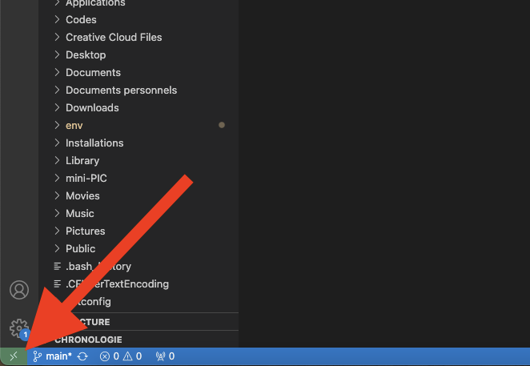
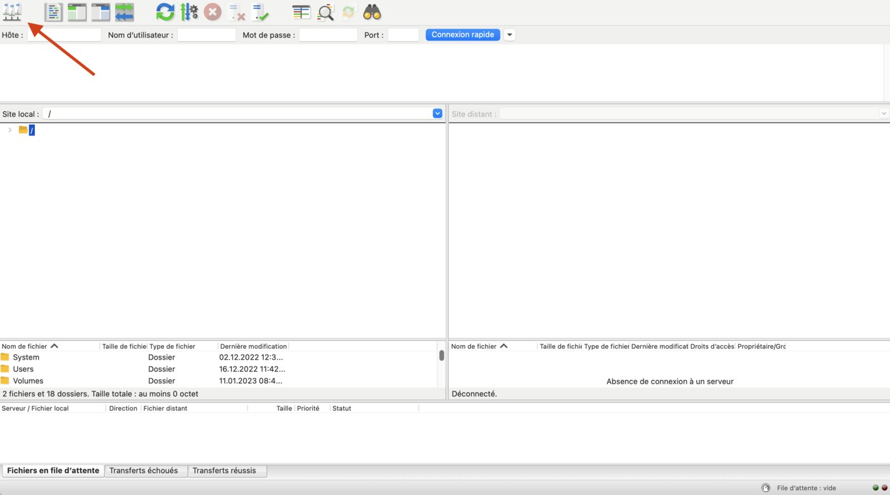

# 2. Connexion et gestion de l'environnement

## Connexion SSH

On se connecte à Ruche depuis un terminal avec la commande `ssh` :

```bash
ssh -XY <votre_login>@ruche.mesocentre.universite-paris-saclay.fr
```

Vous arrivez alors sur la **frontale**, dans votre espace de stockage
`$HOME`.

!!! tip "Les options `-XY`"

    Elles activent le *X11 forwarding* : les fenêtres graphiques ouvertes
    sur Ruche (une figure Matplotlib, par exemple) s'affichent sur votre
    écran.

## Gestion du quota disque

La commande `ruche-quota` indique l'espace disque et le nombre de
fichiers que vous utilisez, par rapport à votre quota :

```console
$ ruche-quota
Disk usage on home :
  quota:  8,4G    / 50G      (16%)
  files:  38 727  / 200 000  (19%)
Disk usage on workdir :
  quota:  160G     / 500G     (31%)
  files:  316 856  / 400 000  (79%)
```

## Éditer du code et transférer des fichiers

=== "Éditeurs (terminal)"

    Les éditeurs disponibles directement sur Ruche fonctionnent dans le
    terminal : `vim`, `emacs`, `nano`.

    ```bash
    nano mon_script.py
    ```

=== "VS Code"

    Vous pouvez aussi vous connecter à Ruche depuis **Visual Studio Code**
    (extension *Remote - SSH*), ou depuis tout éditeur local permettant
    une connexion SSH distante. Vous éditez alors les fichiers de Ruche
    comme s'ils étaient sur votre ordinateur.

    

    :material-book-open-variant: [Guide VS Code du cours](https://github.com/Maison-de-la-Simulation/HPC-DFE-Paris-Saclay/blob/master/documentation/vscode.md)

=== "Transfert : scp"

    Les transferts de fichiers se font avec la commande `scp`, lancée
    **depuis votre ordinateur** :

    ```bash
    # De votre ordinateur vers Ruche
    scp fichier.py <votre_login>@ruche.mesocentre.universite-paris-saclay.fr:~/

    # De Ruche vers votre ordinateur
    scp <votre_login>@ruche.mesocentre.universite-paris-saclay.fr:~/resultats.png .
    ```

=== "Transfert : FileZilla"

    Le logiciel **FileZilla** permet de transférer des fichiers avec une
    interface graphique (protocole SFTP).

    

    :material-book-open-variant: [Guide Ruche du cours](https://github.com/Maison-de-la-Simulation/HPC-DFE-Paris-Saclay/blob/master/documentation/ruche.md)

## Compilateurs, logiciels et bibliothèques : les modules

À la connexion, un super-calculateur fournit un environnement par défaut
qui n'est pas forcément adapté à votre usage. Les super-calculateurs
utilisent la notion de **module** pour charger ou décharger des
compilateurs, des logiciels ou des bibliothèques.

| Commande | Effet |
|---|---|
| `module list` | Affiche les modules actuellement chargés dans votre environnement |
| `module avail` | Liste tous les modules disponibles |
| `module load <module>` | Charge un module |
| `module unload <module>` | Décharge un module |
| `module purge` | Décharge tous les modules chargés |

Par exemple :

```bash
module avail
module load anaconda3/2022.10/gcc-11.2.0
module list
module unload anaconda3/2022.10/gcc-11.2.0
module purge
```

## L'environnement du cours

Pour ce cours, nous utiliserons **Python** avec les bibliothèques
suivantes :

- NumPy
- Matplotlib
- mpi4py

Pour plus de commodité, tout est disponible avec la commande suivante :

```bash
source /gpfs/workdir/labotm/Installations/miniforges3/m2dfe_env.sh
```

!!! tip "À faire à chaque connexion"

    Cette commande ne vaut que pour la session en cours : il faut la
    relancer à chaque connexion, et aussi dans vos scripts SLURM.

## Exercice 1 — Premiers pas sur Ruche

!!! example "Exercice 1"

    Cet exercice a pour but de faire vos premiers pas sur le calculateur
    Ruche.

    :material-file-document: [Énoncé de l'exercice](https://github.com/Maison-de-la-Simulation/HPC-DFE-Paris-Saclay/blob/master/exercices/ruche/1_start.md)

    Vous pouvez aussi l'ouvrir directement sur Ruche, ou dans votre
    éditeur :

    ```bash
    vim exercices/ruche/1_start.md
    ```
